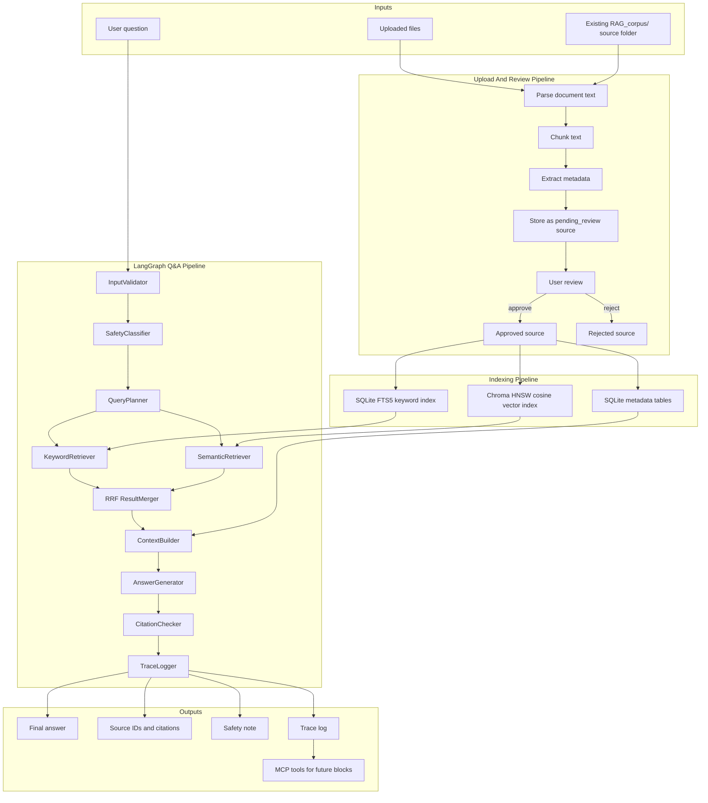

# Evidence-Based Q&A Assistant Development Outline

## 1. Purpose And Scope

The Evidence-Based Q&A Assistant is the first function block of the AI trainer. Its job is to answer user questions using approved reference materials instead of relying only on model memory.

Core responsibilities:

- Allow the user to upload training, nutrition, HYROX, and sport-related materials to the knowledge base.
- Keep uploaded materials in a review state until the user approves them.
- Parse, chunk, index, retrieve, and cite approved materials.
- Answer questions about strength training, bodybuilding, powerlifting, nutrition, HYROX-style hybrid training, and other sports the user is interested in.
- Return evidence-grounded answers with source IDs, citations, safety notes, and debug traces.
- Expose Q&A and knowledge-search capabilities through normal backend APIs and MCP tools so later blocks can reuse them.

Out of scope for this block:

- User profile and long-term memory.
- Training log and check-in storage.
- Training program generation.
- Meal plan generation.
- Wearable, calendar, or external app integrations.

The current `RAG_corpus/` folder should be treated as available source material for future upload/indexing work. This outline does not require modifying, moving, or indexing those files yet.

## 2. Technical Stack And Fixed V1 Choices

Use these choices for v1 unless the project owner explicitly changes them before implementation. The goal is to avoid making new architecture decisions during coding.

### Runtime And Package Baseline

- Language: Python 3.11.
- API server: `FastAPI`.
- UI: `Streamlit`.
- Agent graph: `LangGraph`.
- Metadata ORM: `SQLModel` on top of SQLite.
- Vector database: local persistent `Chroma`.
- MCP: Python MCP SDK with `FastMCP`.
- Test runner: `pytest`.
- Environment config: `.env` loaded with `pydantic-settings`.

### Frontend

- Stack: `Streamlit`.
- Default local URL: `http://localhost:8501`.
- Purpose: provide a minimal local UI for chat, file upload, source review, source listing, and debug inspection.
- Reason: fastest beginner-friendly interface with readable Python code and low setup overhead.
- Important UI views: chat, upload, pending source review, approved source list, answer trace/debug.
- Rule: the UI should stay thin and call backend APIs rather than owning business logic.

### Backend API

- Stack: `FastAPI` with `Pydantic` request and response models.
- Default local URL: `http://localhost:8000`.
- Automatic API docs: `/docs` for Swagger UI and `/redoc` for ReDoc.
- Purpose: expose stable HTTP endpoints for the UI, MCP server, and future function blocks.
- Rule: all core logic should live in backend services and graph nodes.

### Agent Orchestration

- Stack: `LangGraph`.
- Purpose: run the Q&A workflow as explicit, debuggable graph nodes.
- Graph shape: one `StateGraph` for v1, not multiple autonomous agents.
- Rule: each node should be a small Python function/class with typed input and output.
- Persistence: store graph traces in SQLite through the app's own trace tables. Add LangGraph checkpointing only when multi-turn Q&A is introduced.

### LLM And Embeddings

- Chat model: `gpt-5.4-mini`.
- Optional evaluation model: `gpt-5.5` for offline answer-quality checks later.
- Embedding model: `text-embedding-3-large`.
- Embedding dimensions: `1024`.
- API surface: OpenAI Responses API through a provider adapter.
- Purpose:
  - Chat model writes grounded answers from retrieved context.
  - Embedding model turns approved chunks and user queries into vectors for semantic search.
- Rule: model names must live in config, not inside graph nodes.
- Rule: changing embedding model or dimensions after indexing requires re-indexing the Chroma collection.

### Metadata Database

- Stack: SQLite with `SQLModel`.
- Default file path: `data/app.sqlite`.
- Purpose: store source documents, chunks, approval status, answer traces, citation links, and run logs.
- Required tables for v1:
  - `source_documents`
  - `knowledge_chunks`
  - `answer_traces`
  - `citations`
  - `safety_flags`

### Keyword Retrieval

- Stack: SQLite `FTS5`.
- Ranking algorithm: SQLite FTS5 `bm25()`.
- Search scope: approved chunks only.
- Default result count: top 30 chunks.
- Reason: easy to debug because matching rows and terms can be inspected directly.

### Semantic Retrieval

- Stack: `Chroma` persistent local vector store.
- Default persistence path: `data/chroma`.
- Default collection name: `qa_approved_chunks_v1`.
- Retrieval algorithm: Chroma HNSW approximate nearest-neighbor search.
- Distance metric: cosine distance.
- Collection setting: `hnsw.space = "cosine"` at collection creation time.
- Search scope: approved chunks only.
- Default result count: top 30 chunks.

### Document Parsing

- PDF: `PyMuPDF`.
- EPUB: `ebooklib` plus `BeautifulSoup`.
- Markdown/text: standard Python file reading.
- JSON: standard Python JSON loader, especially for structured nutrition data.
- Maximum upload size for v1: 400 MB per file.
- Supported file types for v1: `.pdf`, `.epub`, `.md`, `.txt`, `.json`.
- Rule: parsing should produce plain text plus metadata before any indexing happens.

### MCP Integration

- Stack: Python MCP SDK / `FastMCP`.
- Purpose: expose this block to future blocks through stable tools and resources.
- Initial MCP tools:
  - `ask_qa_assistant`
  - `search_knowledge`
  - `list_approved_sources`
  - `get_answer_trace`
- Rule: MCP tools call the same backend services as the FastAPI endpoints. They must not duplicate retrieval or answer logic.

## 3. Configuration Defaults

All runtime choices should be configurable through environment variables and loaded into one typed settings object.

```text
APP_ENV=local
API_HOST=127.0.0.1
API_PORT=8000
STREAMLIT_PORT=8501

OPENAI_CHAT_MODEL=gpt-5.4-mini
OPENAI_EVAL_MODEL=gpt-5.5
OPENAI_EMBEDDING_MODEL=text-embedding-3-large
OPENAI_EMBEDDING_DIMENSIONS=1024

SQLITE_PATH=data/app.sqlite
CHROMA_PATH=data/chroma
CHROMA_COLLECTION=qa_approved_chunks_v1

UPLOAD_DIR=data/uploads
CHUNK_TARGET_TOKENS=700
CHUNK_OVERLAP_TOKENS=100
KEYWORD_TOP_K=30
SEMANTIC_TOP_K=30
FINAL_CONTEXT_TOP_K=12
MAX_CONTEXT_TOKENS=12000
ANSWER_MAX_TOKENS=1000
HYBRID_RRF_K=60
```

If no API key is configured, the app should still start. `/api/qa/ask` and indexing actions that require embeddings should return a clear configuration error.

## 4. RAG Process Details

### Document Ingestion

Fixed v1 process:

1. User uploads a supported file through Streamlit or `POST /api/knowledge/upload`.
2. Backend saves the original file under `data/uploads/{source_id}/`.
3. Parser extracts plain text plus source metadata.
4. Chunker splits extracted text into chunks.
5. Metadata is stored in SQLite with status `pending_review`.
6. Pending sources are visible in the review UI.
7. Approved sources are indexed into SQLite FTS5 and Chroma.
8. Rejected sources remain stored but are excluded from search.

### Chunking

- Chunk target size: 700 tokens.
- Chunk overlap: 100 tokens.
- Split priority: headings, page boundaries, paragraphs, sentence boundaries, token fallback.
- Every chunk must keep source ID, chunk ID, title, file path or URL, file type, topic tags, page number when available, section heading when available, chunk index, token count, and approval status.
- JSON nutrition files should be chunked by logical record or small record group, not by arbitrary token windows.

### Query Processing

- Normalize whitespace.
- Preserve sport-specific terms and acronyms such as RPE, HYROX, IPF, VO2 max, and 1RM.
- Generate 3 to 8 search terms/synonyms when useful.
- Apply topic hints as soft filters.
- Never search pending or rejected sources.

### Hybrid Retrieval

Use both keyword and semantic retrieval for every normal evidence question.

Keyword retrieval:

- Backend: SQLite FTS5.
- Ranking: `bm25()`.
- Result count: `KEYWORD_TOP_K`, default 30.

Semantic retrieval:

- Backend: Chroma persistent collection.
- Algorithm: HNSW approximate nearest-neighbor search.
- Distance: cosine distance.
- Embedding model: `text-embedding-3-large`.
- Embedding dimensions: 1024.
- Result count: `SEMANTIC_TOP_K`, default 30.

Merge and rerank:

- Use Reciprocal Rank Fusion.
- Formula: `score = sum(1 / (HYBRID_RRF_K + rank))`.
- Default `HYBRID_RRF_K`: 60.
- Deduplicate by `chunk_id`.
- Prefer chunks that appear in both keyword and semantic results.
- Keep the top `FINAL_CONTEXT_TOP_K` chunks, default 12.
- Add neighboring chunks from the same source when needed for context, limited to one previous and one next chunk.
- Hard cap final evidence context at `MAX_CONTEXT_TOKENS`, default 12000.

### Answer Generation

`AnswerGenerator` receives only the user question, safety mode, compact evidence context, and source metadata. It should not read the database directly.

Default answer format:

```text
Short answer:
...

Practical guidance:
...

Evidence used:
- [source_id / chunk_id] title, page/section

Safety note:
...
```

### Citation Checking

- Verify that every cited source ID and chunk ID exists in the retrieved context.
- If a claim cannot be tied to retrieved chunks, remove the claim or mark the answer as insufficiently supported.
- If no relevant chunks are found, return an insufficient-evidence answer instead of guessing.

## 5. Data Pipeline Diagram



## 6. Core Data Objects

These are conceptual objects for the outline. Exact schemas should be defined during implementation using SQLModel and Pydantic.

- `SourceDocument`
  - Required fields: `source_id`, `title`, `source_type`, `file_path`, `source_url`, `topic_tags`, `approval_status`, `uploaded_at`, `reviewed_at`, `review_note`, `parser_status`, `parser_error`.
- `KnowledgeChunk`
  - Required fields: `chunk_id`, `source_id`, `chunk_index`, `text`, `page_number`, `section_heading`, `topic_tags`, `token_count`, `embedding_id`, `approval_status`.
- `AnswerTrace`
  - Required fields: `trace_id`, `question`, `topic_hint`, `safety_mode`, `keyword_chunk_ids`, `semantic_chunk_ids`, `final_chunk_ids`, `answer`, `created_at`, `total_latency_ms`, `error`.
- `Citation`
  - Required fields: `citation_id`, `trace_id`, `source_id`, `chunk_id`, `answer_section`, `citation_text`.
- `SafetyFlag`
  - Required fields: `flag_id`, `trace_id`, `flag_type`, `severity`, `explanation`.

## 7. LangGraph Nodes

Each node should be a small Python function or class with clear input and output. This is more important than clever abstraction.

| Node | Type | Input | Output | Responsibility |
|---|---|---|---|---|
| `InputValidator` | Deterministic code, no LLM | Raw user question, optional topic hint | Clean question, topic hint, validation errors | Reject empty or unusable input early. |
| `SafetyClassifier` | LLM node with rule fallback | Clean question | Safety flags, allowed answer mode | Detect medical, injury, doping, eating disorder, and extreme diet requests. |
| `QueryPlanner` | LLM node | Clean question, topic hint, safety flags | Search query, expanded terms, filters | Prepare keyword and semantic searches. |
| `KeywordRetriever` | Deterministic retrieval, no LLM | Search query, filters | Keyword result chunks | Query SQLite FTS5 over approved chunks only. |
| `SemanticRetriever` | Embedding + vector retrieval, no chat LLM | Search query, filters | Semantic result chunks | Embed the query and query Chroma over approved chunks only. |
| `ResultMerger` | Deterministic code, no LLM | Keyword results, semantic results | Deduplicated ranked chunks | Merge, deduplicate, and rank evidence with Reciprocal Rank Fusion. |
| `ContextBuilder` | Deterministic code, no LLM | Ranked chunks, metadata | Compact evidence context | Build concise context for answer generation. |
| `AnswerGenerator` | LLM node | Question, evidence context, safety flags | Draft answer | Answer only from retrieved evidence. |
| `CitationChecker` | Deterministic code first; optional LLM fallback later | Draft answer, retrieved chunks | Checked answer, citation issues | Ensure cited claims map to retrieved chunks. |
| `TraceLogger` | Deterministic code, no LLM | Full graph state | Trace ID, stored trace | Persist debug data for UI, API, and MCP access. |

Graph state should be a typed object with these fields:

```text
question
topic_hint
clean_question
safety_flags
safety_mode
search_query
query_terms
filters
keyword_results
semantic_results
merged_results
evidence_context
draft_answer
final_answer
citations
trace_id
errors
timings
```

## 8. Interfaces

### FastAPI Endpoints

- `POST /api/qa/ask`
  - Input: question, optional topic hint, optional debug flag.
  - Output: answer, source IDs, citations, safety note, trace ID.
- `POST /api/knowledge/upload`
  - Input: file, optional title, optional topic tags.
  - Output: source ID, parse status, review status.
- `GET /api/knowledge/sources`
  - Input: optional status filter.
  - Output: approved, pending, and rejected source summaries.
- `POST /api/knowledge/{source_id}/approve`
  - Input: source ID, optional corrected metadata.
  - Output: approval status and indexing status.
- `POST /api/knowledge/{source_id}/reject`
  - Input: source ID, optional rejection note.
  - Output: rejection status.
- `GET /api/qa/traces/{trace_id}`
  - Input: trace ID.
  - Output: graph nodes called, retrieved chunks, citations, safety decision, timings, and errors.

### API Schema Examples

`POST /api/qa/ask` request:

```json
{
  "question": "How much protein should I eat to build muscle?",
  "topic_hint": "nutrition",
  "debug": false
}
```

`POST /api/qa/ask` response:

```json
{
  "answer": "...",
  "source_ids": ["src_001"],
  "citations": [
    {
      "source_id": "src_001",
      "chunk_id": "chk_001",
      "title": "ISSN Position Stand Protein and Exercise",
      "page_or_section": "Summary"
    }
  ],
  "safety_note": null,
  "insufficient_evidence": false,
  "trace_id": "trc_001"
}
```

`POST /api/knowledge/upload` response:

```json
{
  "source_id": "src_001",
  "title": "Uploaded file title",
  "parser_status": "parsed",
  "approval_status": "pending_review",
  "chunk_count": 42
}
```

### MCP Tools And Resources

- `ask_qa_assistant`
  - Used by future blocks when they need evidence-grounded answers.
- `search_knowledge`
  - Used by future blocks when they only need retrieved evidence, not a full answer.
- `list_approved_sources`
  - Used by future blocks to inspect available evidence areas.
- `get_answer_trace`
  - Used by developers and future blocks to debug answer behavior.

MCP should be a thin integration layer. It should call the same services as the FastAPI endpoints.

## 9. Source Review And Indexing Rules

- New uploads start as `pending_review`.
- Pending and rejected sources must not be used in answers.
- Approved sources are indexed into both SQLite FTS5 and Chroma.
- Every indexed chunk must keep source ID, chunk ID, document title, file path or source URL, topic tags, page or section if available, and approval status.
- If parsing fails, the source should remain visible with an error status and should not be indexed.

Approval status values:

- `pending_review`
- `approved`
- `rejected`
- `parse_error`
- `index_error`

## 10. Answer Behavior Rules

- Start with a direct answer.
- Explain the practical takeaway.
- Cite the retrieved source IDs used.
- Add a safety note when the question involves injury, medical conditions, doping, eating disorders, extreme dieting, or unsafe behavior.
- Say when the evidence is insufficient.
- Do not invent citations.
- Do not answer from unapproved sources.
- Do not diagnose medical conditions or prescribe treatment.

## 11. Debuggability Rules

- Every answer must show retrieved source IDs.
- Every graph run must store timing, selected nodes, retrieved chunks, final answer, safety flags, and errors.
- The Streamlit UI should include a debug panel showing retrieval results before answer generation.
- The developer should be able to inspect one answer by trace ID and understand:
  - what the user asked
  - which chunks were retrieved
  - why the final answer cited those chunks
  - whether safety handling changed the response
  - how long each stage took

## 12. Suggested Future Project Structure

This is the recommended code organization when implementation begins:

```text
app/
  api/
    main.py
    routes_qa.py
    routes_knowledge.py
  core/
    config.py
    llm_provider.py
  qa/
    graph.py
    nodes.py
    prompts.py
    schemas.py
    service.py
  knowledge/
    parsers.py
    chunking.py
    indexing.py
    retrieval.py
    schemas.py
    service.py
  storage/
    database.py
    models.py
  mcp_server/
    server.py
  ui/
    streamlit_app.py
tests/
  test_upload_review.py
  test_retrieval.py
  test_qa_answers.py
```

Readability rules for implementation:

- Prefer explicit names over clever abstractions.
- Keep graph nodes small and testable.
- Keep database models separate from API schemas.
- Keep prompts in dedicated files.
- Keep UI code thin; it should call backend APIs.
- Log enough data to replay a failed answer.

## 13. Test Plan

### Upload Tests

- PDF upload creates a pending source record.
- Pending sources are not used for answers.
- Approved sources are indexed into SQLite FTS5 and Chroma.
- Rejected sources remain excluded.
- Failed parsing creates a visible error state and does not index chunks.

### Retrieval Tests

- Protein questions retrieve sports nutrition sources.
- Powerlifting questions retrieve strength or powerlifting sources.
- HYROX rule questions retrieve HYROX competition sources.
- Unknown-topic questions return insufficient-evidence behavior.
- Hybrid retrieval returns both keyword and semantic result details in the trace.

### Answer Tests

- Answers include source citations.
- Unsafe medical, doping, eating disorder, or extreme diet questions trigger safety handling.
- Citation checking rejects unsupported claims.
- Trace logs are created for every answer.
- Answers do not cite pending or rejected sources.

### Interface Tests

- FastAPI endpoint responses match their Pydantic schemas.
- MCP tools return the same core results as the backend services.
- Streamlit debug view can display source IDs, retrieved chunks, safety flags, and trace ID.

## 14. Implementation Assumptions

- This file is a planning document only.
- No app code, database migration, generated embeddings, or corpus indexing is required yet.
- The existing `RAG_corpus/` folder is source material for future ingestion and should not be modified by this documentation task.
- V1 should be local-first, easy to read, and easy to debug.
- Later blocks should connect to this block through FastAPI or MCP instead of importing internal retrieval code directly.

## 15. Reference Links For Stack Choices

- FastAPI documentation: https://fastapi.tiangolo.com/
- OpenAI GPT-5.4 mini model page: https://developers.openai.com/api/docs/models/gpt-5.4-mini
- OpenAI embeddings guide: https://platform.openai.com/docs/guides/embeddings
- OpenAI text-embedding-3-large model page: https://platform.openai.com/docs/models/text-embedding-3-large
- LangGraph documentation: https://langchain-ai.github.io/langgraph/
- Chroma documentation: https://docs.trychroma.com/
- Model Context Protocol documentation: https://modelcontextprotocol.io/
- Python MCP SDK / FastMCP: https://github.com/modelcontextprotocol/python-sdk
- PyMuPDF documentation: https://pymupdf.readthedocs.io/
- Streamlit documentation: https://docs.streamlit.io/
