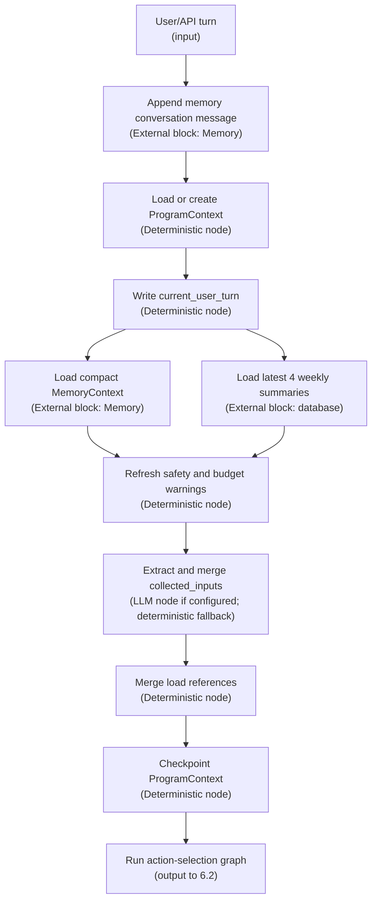
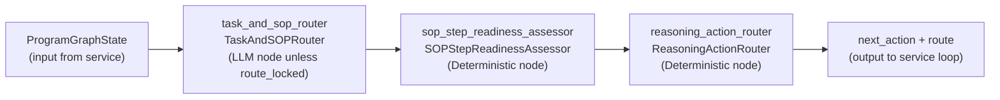
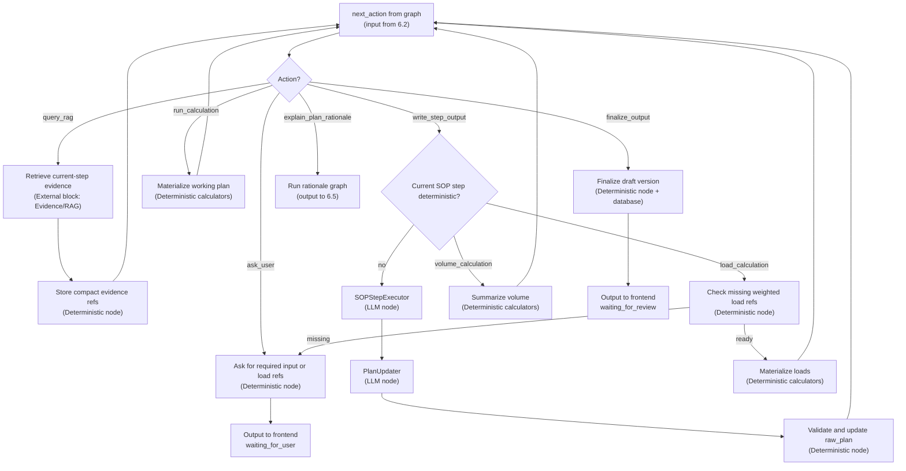
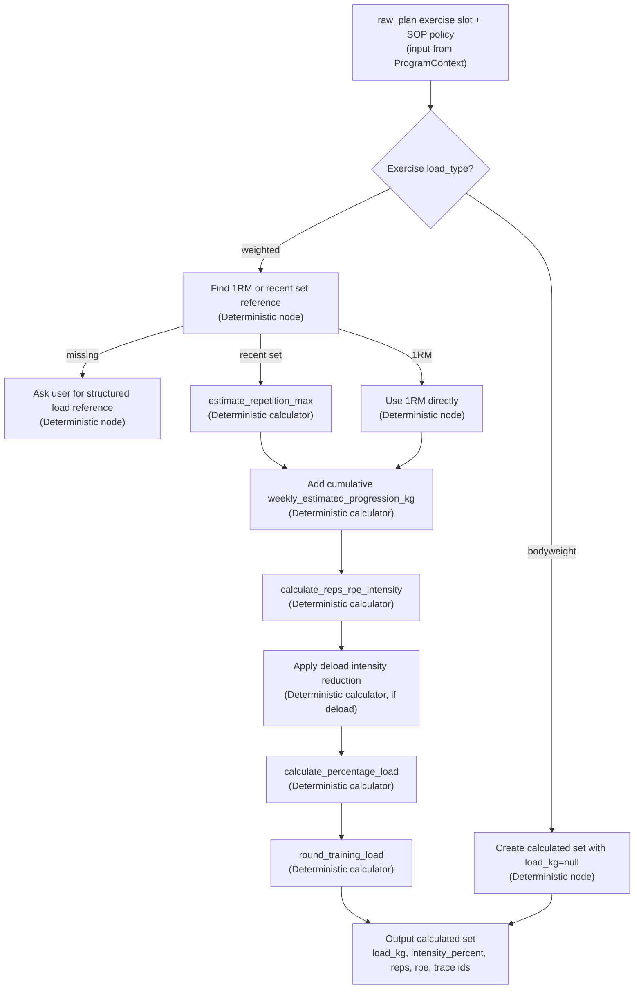
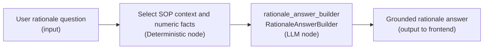

# Stepwise Program Generation Outline

## 1. Purpose And Scope

This outline describes the new-program generation path only.

The generation path creates a strength-training plan through a service-orchestrated reasoning-and-actioning loop. LangGraph selects the current route and next action, while the service maintains one `ProgramContext`, builds a structured `raw_plan` step by step, calculates all numeric prescriptions through deterministic calculator tools, saves a reviewable draft, and waits for user approval.

Out of scope:

- Active-plan changes after missed sessions or user feedback.
- Memory block internals.
- Evidence corpus ingestion and indexing.
- Medical diagnosis or exercise clearance.

## 2. Key Design Rule

The generator does not ask the LLM to write a whole program in one shot.

Before the first SOP write, deterministic code creates an empty but structured `raw_plan`. Each non-calculator SOP step then uses two LLM-backed service actions:

- `SOPStepExecutor`: writes the decision for the current SOP step.
- `PlanUpdater`: updates the structured `raw_plan` according to that decision.

The calculator steps are deterministic and do not call RAG or an LLM.

## 3. ProgramContext Sections Used

Required sections:

- `current_user_turn`: latest user message metadata and normalized content.
- `memory_context`: compact MemoryContext from the Memory block.
- `latest_four_week_summary_notes`: real-world-time training-level summaries for the latest 4 natural weeks.
- `retrieved_evidence`: current SOP step evidence only.
- `user_clarification_answers`: user answers to missing-input questions.
- `sop_progress`: active SOP, completed steps, decisions by step, counters, evidence refs, and completion flag.
- `new_program_working_state`: collected inputs, task request, `raw_plan`, pending load clarifications, and calculation artifacts.
- `draft_artifacts`: saved draft `program_id`, `version_id`, and version number after finalization.
- `safety_flags_and_budget_warnings`: safety blocks and context-budget warnings.

## 4. Raw Plan Schema

The initial `raw_plan` is created deterministically before the first `SOPStepExecutor` call.

Minimum shape:

```json
{
  "schema": "raw_training_plan_v1",
  "title": "",
  "goal": "",
  "sport": "strength",
  "rationale": "",
  "task_request": "",
  "templates": {
    "session": {"name": "", "goal": "", "duration_minutes": 60, "exercises": []},
    "exercise": {
      "name": "",
      "mode": "resistance",
      "load_type": "weighted",
      "sets": 0,
      "reps": 0,
      "intensity_percent": null,
      "rpe": null,
      "rest_seconds": null,
      "notes": ""
    }
  },
  "sessions": [],
  "assumptions": [],
  "warnings": []
}
```

The `templates` object is protected. `PlanUpdater` may fill or expand the plan, but it must not remove `templates.session` or `templates.exercise`.

`raw_plan` must not include `templates.set` or `sets_template`; repeated sets are represented by compact exercise-level fields such as `sets`, `reps`, `rpe`, and `rest_seconds`, then expanded deterministically during calculation.

`raw_plan` must not contain `screening`, `needs_analysis`, `periodization` or `planning_model`.Those fields belong in `sop_progress.decisions` and are composed into the saved `ProgramVersion` only during finalization.

## 5. Generation SOP

Ordered steps:

1. `consultation_and_screening` :collect health, injury/pain, lifestyle, readiness, medication changes, and relevant history; require clearance when risk is elevated.
2. `needs_analysis` : define goal/sport demands, training status, constraints, schedule, equipment, movement needs, and limiting factors.
3. `periodization` : establish the macrocycle, mesocycles, microcycles, phases, and target timeline.
4. `planning_model` : choose `parallel`, `sequential`, or `emphasis` and record why.
5. `programming_exercises_and_order` : based on needs analysis and retrieved knowledges, choose exercises, their training frequency, and decide their order in a session.
6. `programming_intensity_and_volume` : based on existing SOP decisions and retrieved knowledges, for each arranged exercise slot in each session, choose sets, repetitions, target RPE, weekly estimated 1RM progression in kg, deload reductions, loading patterns, set types, and session types. This step does not directly write final `load_kg`.
7. `load_calculation` : calculate `load_kg` for each exercise in each session.
  Every exercise must be classified as `weighted` or `bodyweight`. A weighted exercise requires an available 1RM record or recent weight-and-repetition record for that exercise in Memory, or a current user-provided 1RM/recent set. If no valid load reference exists in the memory, ask the user for that raw performance input and estimate the exercise 1RM with a deterministic calculator before calculating every `load_kg`. Only bodyweight exercises may retain `load_kg=null`.
8. `volume_calculation` : calculate session and week workload in suitable units.
9. `rest_periods` : calculate recovery intervals after intensity and volume are known.

LLM/RAG steps:

- Steps 1-6 and 9 may retrieve approved evidence.
- `SOPStepExecutor` writes one decision into `sop_progress.decisions[step]`.
- `PlanUpdater` returns the complete updated `raw_plan`.

Deterministic steps:

- `load_calculation`: calculates every weighted exercise load from Memory 1RM data or current user-provided 1RM/recent set. It derives intensity from `reps_per_set` and `target_rpe`, applies cumulative `weekly_estimated_progression_kg`, applies deload reductions when relevant, then calculates and rounds `load_kg`. If a weighted exercise lacks a valid reference, ask the user before calculation. Bodyweight exercises may keep `load_kg = null`.
- `volume_calculation`: calculates exercise, session, and weekly workload summaries from the calculated prescriptions.

## 6. Main Data Pipeline

The current implementation separates orchestration from graph node selection. The service owns context loading, evidence calls, calculator calls, persistence, and most ProgramContext updates. LangGraph is currently used for small routing graphs that choose the next action or build rationale answers.

Node labels:

- `LLM node` means the node calls the configured chat model.
- `Deterministic node` means ordinary code, validation, calculator code, or database/service logic.
- `External block` means another block such as Memory, Evidence/RAG, or the database.

### 6.1 Turn Intake And Context Preparation



Node functions:

- `Append memory conversation message` (`External block`): records the user turn through the Memory block conversation path.
- `Load or create ProgramContext` (`Deterministic node`): opens the existing program context or creates a new one for this conversation.
- `Write current_user_turn` (`Deterministic node`): stores the latest user message inside ProgramContext.
- `Load compact MemoryContext` (`External block`): gets profile, recent status, and compact active-plan context from Memory.
- `Load latest 4 weekly summaries` (`External block`): gets real-world weekly training summary notes.
- `Refresh safety and budget warnings` (`Deterministic node`): updates red-flag and context budget warnings.
- `Extract and merge collected_inputs` (`LLM node if configured; deterministic fallback`): extracts required inputs from the user turn first, then merges recent status/profile fallbacks.
- `Merge load references` (`Deterministic node`): merges structured load-reference answers and supported free-text load references.
- `Checkpoint ProgramContext` (`Deterministic node`): persists the prepared context revision before the reasoning loop.

### 6.2 LangGraph Action-Selection Graph



Node functions:

- `task_and_sop_router` (`LLM node unless route_locked`): classifies the turn as `new_program`, `clarification_answer`, or `explain_plan_rationale`. Inside the bounded generation loop, `route_locked=True`, so it reuses the current route without another model call.
- `sop_step_readiness_assessor` (`Deterministic node`): checks required inputs, current SOP step, completed steps, evidence sufficiency, pending load references, raw-plan presence, and calculated-plan presence.
- `reasoning_action_router` (`Deterministic node`): chooses exactly one next action: `ask_user`, `query_rag`, `write_step_output`, `run_calculation`, `finalize_output`, or `explain_plan_rationale`.

Current implementation note: `SOPStepExecutor` and `PlanUpdater` are not registered LangGraph nodes. They are LLM-backed service actions that run after `reasoning_action_router` returns `write_step_output`.

### 6.3 Service Action Execution Loop



Node functions:

- `Ask for required input or load refs` (`Deterministic node`): asks for missing required inputs or structured load references. Load-reference questions can be answered through `ProgramTurnRequest.load_references`.
- `Retrieve current-step evidence` (`External block`): retrieves evidence only for the current SOP step.
- `Store compact evidence refs` (`Deterministic node`): stores retrieved evidence for the current step and marks evidence sufficiency.
- `SOPStepExecutor` (`LLM node`): writes the current SOP-step decision into `sop_progress.decisions[step]`.
- `PlanUpdater` (`LLM node`): updates the deterministic `raw_plan` object according to the new SOP decision and previous decisions.
- `Validate and update raw_plan` (`Deterministic node`): verifies that required raw-plan structure and templates remain valid, strips duplicated SOP metadata, updates pending load clarifications, advances the SOP step, and checkpoints ProgramContext.
- `Check missing weighted load refs` (`Deterministic node`): verifies that every weighted exercise has a valid 1RM or recent set reference before load calculation.
- `Materialize loads` (`Deterministic calculators`): expands sessions across weeks, estimates missing 1RMs from recent sets, derives set intensity from reps and RPE, applies progression and deload reductions, calculates `load_kg`, rounds loads, and records calculation traces.
- `calculation_artifacts.calculated_sessions` stores compact `set_groups` instead of repeated identical set rows. Full set rows are expanded only when finalizing or serving a full review object.
- `Summarize volume` (`Deterministic calculators`): calculates exercise, session, and weekly workload summaries from the calculated sessions.
- `Materialize working plan` (`Deterministic calculators`): fallback calculation pass when the SOP is complete but calculated artifacts are missing.
- `Finalize draft version` (`Deterministic node + database`): assembles the reviewable draft `ProgramVersion` from SOP decisions, raw plan, and calculation artifacts, then saves draft rows.
- `Run rationale graph` (`output to 6.5`): diverts rationale questions to the separate rationale graph instead of continuing the generation loop.

### 6.4 Load Calculation Subflow



Node functions:

- `Find 1RM or recent set reference` (`Deterministic node`): reads collected load references and memory-derived lift records; active-plan performance is not used as a new load reference.
- `estimate_repetition_max` (`Deterministic calculator`): converts a recent weighted set into an estimated 1RM.
- `Add cumulative weekly_estimated_progression_kg` (`Deterministic calculator`): adjusts the exercise slot's estimated 1RM by the week-specific progression decisions already reached by the SOP.
- `calculate_reps_rpe_intensity` (`Deterministic calculator`): derives the set's percent 1RM from `reps_per_set` and `target_rpe`.
- `Apply deload intensity reduction` (`Deterministic calculator`): reduces calculated intensity during deload weeks according to the SOP decision.
- `calculate_percentage_load` (`Deterministic calculator`): converts effective 1RM and calculated intensity into raw load.
- `round_training_load` (`Deterministic calculator`): rounds the raw load to a practical training load.

### 6.5 Rationale Answer Graph



Node functions:

- `Select SOP context and numeric facts` (`Deterministic node`): gathers relevant SOP progress, draft/calculated-plan context, and matching calculation facts before the model call.
- `rationale_answer_builder` (`LLM node`): tailors the answer to the user's exact rationale question while staying grounded in stored SOP progress, context, and numeric facts.


Inputs from Memory:

- Profile and recent status.
- Compact active-plan progress only when needed for context, not as the source of new load references.
- Latest 4 natural-week training summary notes.

Inputs from Evidence/RAG:

- Retrieved chunks for the current SOP step only.
- Evidence references are stored in `sop_progress.evidence_refs_by_step`.

Outputs:

- Updated `ProgramContext`.
- `ProgramTrace`, `ProgramToolCall`, `CalculationTrace`, `ProgramCitation`, and safety flags for audit.
- Draft `TrainingProgram` and `ProgramVersion`.

## 7. Load Reference Rule

For every exercise in `raw_plan.sessions`:

- Classify as `weighted` or `bodyweight`.
- Always classify pull-up, chin-up, dip, and their variations as `weighted` for calculation. For these exercises, RM conversion uses total system load (`bodyweight_kg + external_load_kg`), but user-facing `load_kg` stores only the external load to add.
- `weighted` requires one of:
  - known 1RM in Memory/profile,
  - current user-provided 1RM,
  - current user-provided recent weight-and-repetition record.
- If recent performance is provided, estimate 1RM with a deterministic calculator.
- Do not use active-plan performance as a load reference for new load calculation.
- For weighted exercises, calculate set intensity from the planned `reps_per_set` and `target_rpe`; then calculate `load_kg` from the effective 1RM after cumulative `weekly_estimated_progression_kg` and any deload reduction.
- Only bodyweight exercises may retain `load_kg = null`.

## 8. Finalization

After all SOP steps complete:

- Use calculation artifacts plus `raw_plan` to create the persisted calculated plan.
- Expand compact `set_groups` into individual set rows, then save draft program/version/session/exercise/set rows.
- Keep full calculation traces in the database.
- Keep ProgramContext calculation summaries compact; do not duplicate full trace rows inside ProgramContext.
- Return a draft response for frontend review.

Approval is separate from generation. When approved, the Program Generator activates the approved plan through the Memory block, and the Memory block remains the canonical owner of active plan progress.

## 9. Test Requirements

Minimum tests:

- Empty deterministic `raw_plan` includes `templates.session` and `templates.exercise`.
- New-program generation completes all 9 SOP steps.
- Deterministic calculator steps do not trigger RAG queries.
- Weighted exercises without a valid load reference ask the user.
- Bodyweight exercises may keep `load_kg = null`.
- Draft finalization saves traced numeric prescriptions.
- ProgramContext stays compact enough to avoid avoidable budget warnings.
