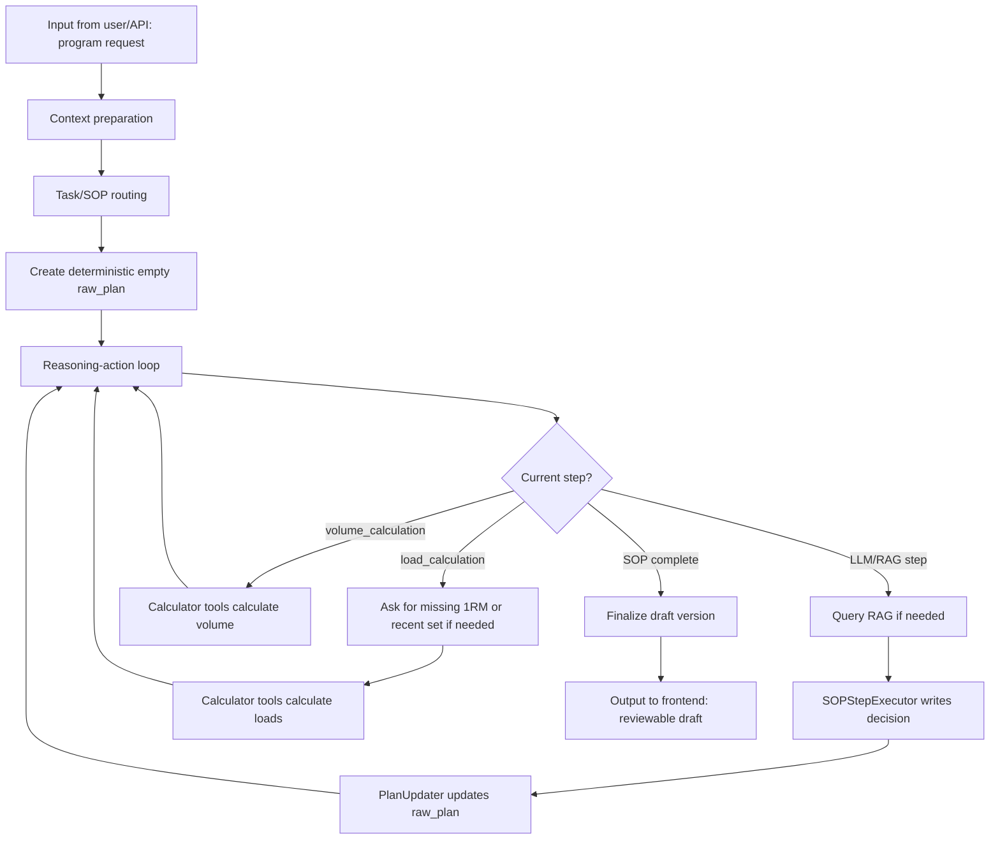

# Stepwise Program Generation Outline

## 1. Purpose And Scope

This outline describes the new-program generation path only.

The generation path creates a strength-training plan through a LangGraph reasoning-and-actioning loop. The graph maintains one `ProgramContext`, builds a structured `raw_plan` step by step, calculates all numeric prescriptions through deterministic calculator tools, saves a reviewable draft, and waits for user approval.

Out of scope:

- Active-plan changes after missed sessions or user feedback.
- Memory block internals.
- Evidence corpus ingestion and indexing.
- Medical diagnosis or exercise clearance.

## 2. Key Design Rule

The generator does not ask the LLM to write a whole program in one shot.

Before the first SOP write, deterministic code creates an empty but structured `raw_plan`. Each non-calculator SOP step then uses two LLM nodes:

- `SOPStepExecutor`: writes the decision for the current SOP step.
- `PlanUpdater`: updates the structured `raw_plan` according to that decision.

The calculator steps are deterministic and do not call RAG or an LLM.

## 3. ProgramContext Sections Used

Required sections:

- `current_user_turn`: latest user message metadata and normalized content.
- `memory_context`: compact MemoryContext from the Memory block.
- `latest_four_week_summary_notes`: real-world-time training-level summaries for the latest 4 natural weeks.
- `retrieved_evidence`: current SOP step evidence only.
- `user_clarification_answers`: user answers to missing-input questions.
- `sop_progress`: active SOP, completed steps, decisions by step, counters, evidence refs, and completion flag.
- `new_program_working_state`: collected inputs, task request, `raw_plan`, pending load clarifications, and calculation artifacts.
- `draft_artifacts`: saved draft `program_id`, `version_id`, and version number after finalization.
- `safety_flags_and_budget_warnings`: safety blocks and context-budget warnings.

## 4. Raw Plan Schema

The initial `raw_plan` is created deterministically before the first `SOPStepExecutor` call.

Minimum shape:

```json
{
  "schema": "raw_training_plan_v1",
  "title": "",
  "goal": "",
  "sport": "strength",
  "rationale": "",
  "task_request": "",
  "templates": {
    "session": {"name": "", "goal": "", "duration_minutes": 60, "exercises": []},
    "exercise": {
      "name": "",
      "mode": "resistance",
      "load_type": "weighted",
      "sets": 0,
      "reps": 0,
      "intensity_percent": null,
      "rpe": null,
      "rest_seconds": null,
      "notes": "",
      "sets_template": []
    },
    "set": {
      "set_number": 1,
      "reps": 0,
      "load_kg": null,
      "intensity_percent": null,
      "rpe": null,
      "rest_seconds": null
    }
  },
  "sessions": [],
  "assumptions": [],
  "warnings": []
}
```

The `templates` object is protected. `PlanUpdater` may fill or expand the plan, but it must not remove `templates.session`, `templates.exercise`, or `templates.set`.

`raw_plan` must not contain `screening`, `needs_analysis`, `periodization` or `planning_model`.Those fields belong in `sop_progress.decisions` and are composed into the saved `ProgramVersion` only during finalization.

## 5. Generation SOP

Ordered steps:

1. `consultation_and_screening` :collect health, injury/pain, lifestyle, readiness, medication changes, and relevant history; require clearance when risk is elevated.
2. `needs_analysis` : define goal/sport demands, training status, constraints, schedule, equipment, movement needs, and limiting factors.
3. `periodization` : establish the macrocycle, mesocycles, microcycles, phases, and target timeline.
4. `planning_model` : choose `parallel`, `sequential`, or `emphasis` and record why.
5. `programming_exercises_and_order` : based on needs analysis and retrieved knowledges, choose exercises, their training frequency, and decide their order in a session.
6. `programming_intensity_and_volume` : based on existing SOP decisions and retrieved knowledges, for each planned exercises, choose their intensities, repetitions, loading patterns, set types, and session types.
7. `load_calculation` : calculate `load_kg` for each exercise in each session.
  Every exercise must be classified as `weighted` or `bodyweight`. A weighted exercise requires an available 1RM record or recent weight-and-repetition record for that exercise in Memory, or a current user-provided 1RM. If no valid load reference exists in the memory, ask the user for that raw performance input and estimate the exercise 1RM with a deterministic calculator before calculating every `load_kg`. Only bodyweight exercises may retain `load_kg=null`.
8. `volume_calculation` : calculate session and week workload in suitable units.
9. `rest_periods` : calculate recovery intervals after intensity and volume are known.

LLM/RAG steps:

- Steps 1-6 and 9 may retrieve approved evidence.
- `SOPStepExecutor` writes one decision into `sop_progress.decisions[step]`.
- `PlanUpdater` returns the complete updated `raw_plan`.

Deterministic steps:

- `load_calculation`: calculates every weighted exercise load from Memory 1RM data or current user-provided 1RM/recent set. If a weighted exercise lacks a valid reference, ask the user before calculation. Bodyweight exercises may keep `load_kg = null`.
- `volume_calculation`: calculates exercise, session, and weekly workload summaries from the calculated prescriptions.

## 6. Main Data Pipeline




Inputs from Memory:

- Profile and recent status.
- Compact active-plan progress only when needed for context, not as the source of new load references.
- Latest 4 natural-week training summary notes.

Inputs from Evidence/RAG:

- Retrieved chunks for the current SOP step only.
- Evidence references are stored in `sop_progress.evidence_refs_by_step`.

Outputs:

- Updated `ProgramContext`.
- `ProgramTrace`, `ProgramToolCall`, `CalculationTrace`, `ProgramCitation`, and safety flags for audit.
- Draft `TrainingProgram` and `ProgramVersion`.

## 7. Load Reference Rule

For every exercise in `raw_plan.sessions`:

- Classify as `weighted` or `bodyweight`.
- `weighted` requires one of:
  - known 1RM in Memory/profile,
  - current user-provided 1RM,
  - current user-provided recent weight-and-repetition record.
- If recent performance is provided, estimate 1RM with a deterministic calculator.
- Do not use active-plan performance as a load reference for new load calculation.
- Only bodyweight exercises may retain `load_kg = null`.

## 8. Finalization

After all SOP steps complete:

- Use calculation artifacts plus `raw_plan` to create the persisted calculated plan.
- Save draft program/version/session/exercise/set rows.
- Keep full calculation traces in the database.
- Keep ProgramContext calculation summaries compact; do not duplicate full trace rows inside ProgramContext.
- Return a draft response for frontend review.

Approval is separate from generation. When approved, the Program Generator activates the approved plan through the Memory block, and the Memory block remains the canonical owner of active plan progress.

## 9. Test Requirements

Minimum tests:

- Empty deterministic `raw_plan` includes `templates.session`, `templates.exercise`, and `templates.set`.
- New-program generation completes all 9 SOP steps.
- Deterministic calculator steps do not trigger RAG queries.
- Weighted exercises without a valid load reference ask the user.
- Bodyweight exercises may keep `load_kg = null`.
- Draft finalization saves traced numeric prescriptions.
- ProgramContext stays compact enough to avoid avoidable budget warnings.

