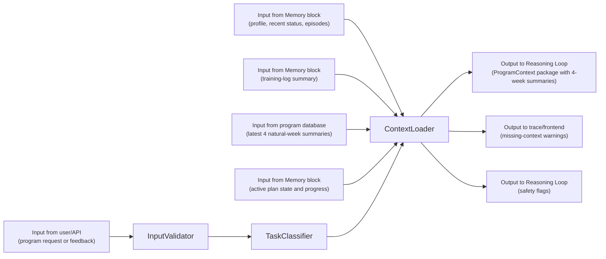
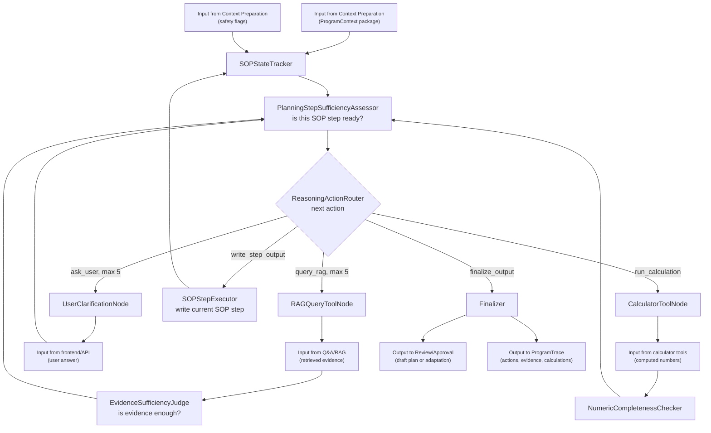
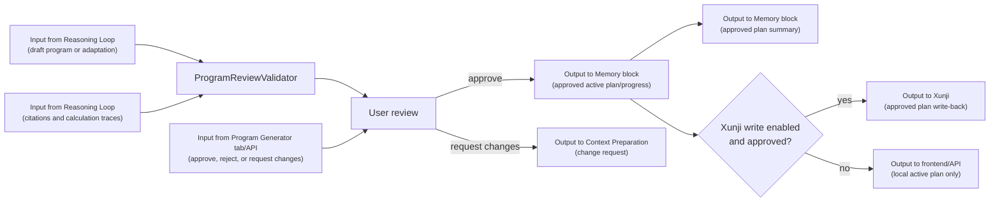
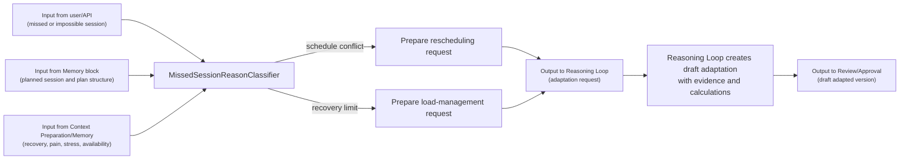

# Check-In And Program Generator Development Outline

## 1. Purpose And Scope

The Check-In And Program Generator is the planning and adaptation block of the AI trainer. Its job is to use direct user feedback, training summaries, user memory, approved evidence, and deterministic calculation tools to create, review, track, and adapt training programs.

Core responsibilities:

- Keep natural-week training-level summary notes and retrieve the latest 4 natural weeks for program generation and adaptation.
- Generate professional training plans from user-provided information, the User Profile And Memory block, training summaries, direct readiness/recovery feedback, active plan state, and approved evidence retrieved from the Evidence-Based Q&A Assistant.
- Explain the rationale behind generated or adapted plans with evidence references, user-memory references, training-summary references, and calculation traces.
- Ask the user for missing raw information when the current context is insufficient, such as goals, schedule, current training level, available equipment, readiness, pain, or recent performance.
- Use a LangGraph reasoning-and-actioning loop that can decide whether to query RAG, ask the user, run deterministic calculation tools, or produce a plan step.
- Pre-calculate every numeric plan prescription through deterministic tools, including weights, sets, reps, rest times, paces, durations, intensities, volume totals, and progression increments.
- Save generated plans as draft plan versions, activate them only after user approval, track planned sessions against completed or missed sessions, and write approved plans to Xunji when configured.
- Adapt the remaining plan when the user misses or cannot complete a planned session because of schedule conflicts, sickness, poor sleep, insufficient recovery, insufficient training level, pain, or other feedback.
- Expose generation, review, adaptation, calculator, summary, and trace capabilities through backend APIs and MCP tools.

Out of scope for this block:

- Evidence corpus upload, approval, chunking, indexing, and retrieval internals.
- Long-term user profile memory, episodic conversation memory, and recent-status memory internals.
- Meal plan generation.
- Diagnosing medical conditions, prescribing treatment, or clearing users for exercise when medical review is required.
- Wearable, calendar, or external app integrations except for optional Xunji write-back after explicit user approval.

Boundary rule for v1:

- This block owns training summary notes, program drafts, program versions, session prescriptions, adaptation records, calculation traces, and program traces.
- The User Profile And Memory block owns profile facts, recent status, conversation memory, and imported historical log retrieval. This block consumes those through stable APIs or MCP tools, then may write approved training plan back for memory retrieval.
- The Evidence-Based Q&A Assistant owns approved evidence and RAG retrieval. This block consumes it through `search_knowledge` or `ask_qa_assistant`; it must not read the knowledge database directly.

## 2. Technical Stack And Fixed V1 Choices

Use these choices for v1 unless the project owner explicitly changes them before implementation.

### Runtime And Package Baseline

- Language: Python 3.11.
- API server: `FastAPI`.
- UI: `Streamlit`.
- Agent graph: `LangGraph`.
- Metadata ORM: `SQLModel` on top of SQLite.
- MCP: Python MCP SDK with `FastMCP`.
- Test runner: `pytest`.
- Environment config: `.env` loaded with `pydantic-settings`.
- LLM provider: reuse the app provider adapter already used by Q&A and memory.

### Frontend

- Stack: `Streamlit`.
- Required tab: a dedicated `Program Generator` tab.
- The `Program Generator` tab should be separate from the existing `Training Log` and `Memory` tabs.
- The tab should contain program-generation request input, readiness/recovery feedback fields when relevant, missing-information prompts, draft-plan review, calculation/evidence trace display, approval controls, active-plan status, and missed-session adaptation controls.
- Rule: the UI stays thin and calls backend APIs. It should not own plan logic, calculation logic, RAG logic, or adaptation policy.

### Backend API

- Stack: `FastAPI` with `Pydantic` request and response models.
- Purpose: expose stable HTTP endpoints for Streamlit, MCP tools, and future integrations.
- Rule: all core logic lives in service classes, graph nodes, and calculator helpers.
- Rule: active plans become user-visible and trackable only after explicit approval.

### Agent Orchestration

- Stack: `LangGraph`.
- Main graph: one `ProgramGeneratorGraph` for program generation, program review, summary-aware context preparation, and adaptation.
- Graph style: reasoning and actioning, similar to a ReAct loop but with typed state, explicit actions, counters, and deterministic validators.
- Allowed graph actions:
  - `query_rag`
  - `ask_user`
  - `retrieve_memory`
  - `retrieve_training_summary`
  - `run_calculation`
  - `write_step_output`
  - `finalize_output`
- Loop limit:
  - At most 5 RAG queries per run.
  - At most 5 user clarification questions per run.
  - Calculation tool calls are not counted as RAG or user questions, but every calculation must be logged.
- If the graph reaches either query limit, it must produce the best safe output for the current question or current SOP step, with explicit assumptions, missing inputs, and safety limits.

### LLM And Evidence Use

- Chat model: use latest and strongest OpenAI GPT model.
- Evidence retrieval: call the Q&A block through MCP or service APIs.
- Memory retrieval: call the User Profile And Memory block through MCP or service APIs.
- Rule: the generator may use LLM reasoning to decide what to ask or query next, but evidence claims in the final plan rationale must be tied to retrieved sources.
- Rule: if evidence is insufficient after allowed RAG attempts, the output should mark the evidence gap instead of inventing support.

### Calculation And MCP Integration

- Every numeric prescription in a generated or adapted plan must be created or validated by deterministic tools.
- Each numeric value must store:
  - value
  - unit
  - input values
  - formula or method
  - rounding policy
  - tool name
  - tool call ID
  - source of each input, such as profile, recent status, training summary, user answer, evidence, or assumption.
- The LLM must not ask the user to calculate 1RM, percentages, training loads, rest times, durations, paces, or weekly volume.
- The LLM may ask the user for raw information, such as a recent best set, available plates, target race pace, session duration, or number of available training days.

Initial calculator MCP tools, including the required RM calculator:

- `calculate_expression`
- `estimate_repetition_max` as the repetition-max/RM calculator
- `calculate_percentage_load`
- `round_training_load`
- `calculate_volume_load`
- `calculate_session_duration`
- `calculate_rest_interval`
- `calculate_distance_pace_time`
- `calculate_weekly_frequency`
- `calculate_progression_increment`

MCP tools should call the same backend calculator service as the FastAPI endpoints. They must not duplicate formula logic.

### Metadata Database

Use SQLite with `SQLModel` at `data/app.sqlite`.

Required tables for v1:

- `check_ins`
- `training_summary_notes`
- `program_requests`
- `training_programs`
- `program_versions`
- `program_sessions`
- `exercise_prescriptions`
- `set_prescriptions`
- `program_adaptations`
- `program_traces`
- `program_tool_calls`
- `calculation_traces`
- `program_citations`
- `program_safety_flags`

## 3. Configuration Defaults

All runtime choices should be configurable through environment variables and loaded into the existing typed settings object.

```text
PROGRAM_MAX_RAG_QUERIES=5
PROGRAM_MAX_USER_QUESTIONS=5
PROGRAM_MAX_SOP_STEPS_PER_RUN=12
PROGRAM_MAX_CONTEXT_TOKENS=34000
PROGRAM_EVIDENCE_CONTEXT_TOP_K=12
PROGRAM_DEFAULT_UNITS=metric

PROGRAM_BARBELL_LOAD_ROUNDING_KG=0.5
PROGRAM_DUMBBELL_LOAD_ROUNDING_KG=2.0
PROGRAM_MACHINE_LOAD_ROUNDING_KG=2.5
PROGRAM_BODYWEIGHT_LOAD_ROUNDING_KG=0.5
PROGRAM_REST_ROUNDING_SECONDS=5
PROGRAM_DURATION_ROUNDING_SECONDS=60
PROGRAM_PACE_ROUNDING_SECONDS_PER_KM=1

PROGRAM_REQUIRE_APPROVAL_BEFORE_ACTIVATION=true
PROGRAM_REQUIRE_APPROVAL_BEFORE_XUNJI_WRITE=true
PROGRAM_XUNJI_WRITE_ENABLED=false
```

If no LLM API key is configured, the app should still start. Program-generation endpoints should return a clear configuration error. Calculator endpoints should continue to work without an LLM key.

## 4. Main Data Pipeline Diagrams

The complete pipeline is split into smaller diagrams so each subsection has clear inputs, outputs, and handoff points. In the diagrams, handoff blocks use plain `Input from...` and `Output to...` labels, with the actual data/action text on a lighter second line in parentheses.

### 4.1 Context Preparation

Inputs:

| Input | From |
|---|---|
| Clean user request | `Program Generator` tab or program API |
| Task type | `InputValidator` and `TaskClassifier` |
| Memory context | User Profile And Memory block |
| Recent status | User Profile And Memory block |
| Training-log summary | User Profile And Memory block |
| Latest 4 natural-week training-level summary notes | Check-In And Program Generator database |
| Active plan state and progress | User Profile And Memory block |

Outputs:

| Output | To |
|---|---|
| `ProgramContext` package | `Reasoning And Actioning Loop` |
| Missing-context warnings | `Reasoning And Actioning Loop` and frontend trace view |
| Latest 4 natural-week summary notes included read-only | `ProgramContext` |
| Safety flags from red-flag feedback or recent-status memory | `Reasoning And Actioning Loop` |



### 4.2 Reasoning And Actioning Loop

Inputs:

| Input | From |
|---|---|
| `ProgramContext` package | `Context Preparation` |
| Safety flags | `Context Preparation` |
| Retrieved evidence | Evidence-Based Q&A Assistant, through `RAGQueryToolNode` |
| User clarification answers | Frontend/API response to `UserClarificationNode` |
| Calculation results | Calculator MCP/backend tools |

Outputs:

| Output | To |
|---|---|
| Draft program or draft adaptation | `Program Review, Approval, And Activation` |
| Current SOP step output, when partial output is needed | Frontend/API and `ProgramTrace` |
| Evidence, user-question, action, and calculation traces | `ProgramTrace` storage |
| Request for user clarification | Frontend/API |
| Request for RAG evidence | Evidence-Based Q&A Assistant |
| Request for deterministic calculation | Calculator MCP/backend tools |



### 4.3 Program Review, Approval, And Activation

Inputs:

| Input | From |
|---|---|
| Draft program or draft adaptation | `Reasoning And Actioning Loop` |
| User approval, rejection, or requested changes | `Program Generator` tab or program API |
| Calculation traces and citations | `Reasoning And Actioning Loop` |

Outputs:

| Output | To |
|---|---|
| Approved active plan/progress update | User Profile And Memory block and `Context Preparation` |
| Approved plan summary | User Profile And Memory block |
| Approved plan write-back | Xunji, only when enabled and explicitly approved |
| Requested changes | `Context Preparation` and `Reasoning And Actioning Loop` |
| Final plan, rationale, trace ID, and safety notes | Frontend/API |



### 4.4 Missed Or Impossible Session Adaptation

Inputs:

| Input | From |
|---|---|
| Missed-session report or impossible-session feedback | `Program Generator` tab or program API |
| Active program and planned session | User Profile And Memory block |
| Readiness, recovery, pain, illness, stress, and availability | `Context Preparation` and User Profile And Memory block |
| Evidence and calculation requests | `Reasoning And Actioning Loop` |

Outputs:

| Output | To |
|---|---|
| Adaptation request with reason category | `Reasoning And Actioning Loop` |
| Draft adapted version | `Program Review, Approval, And Activation` |
| Adaptation trace and calculation traces | `ProgramTrace` storage |



## 5. Context Preparation And Summary Notes

V1 should not create a separate readiness-feedback storage pipeline. Readiness, recovery, soreness, pain, illness, stress, schedule, equipment, session completion, and plan feedback should enter this block as:

- direct user feedback in a program-generation, review, or adaptation request
- recent-status memory from the User Profile And Memory block
- training-log summaries from the User Profile And Memory block
- active-plan progress from the User Profile And Memory block

Health and safety rule:

- If direct feedback or recent-status memory includes chest pain, fainting, severe symptoms, acute injury, uncontrolled medical issues, or any other elevated-risk condition, the graph should pause normal plan generation and return a medical-clearance or professional-care recommendation rather than writing a normal training prescription.

### Summary Notes

The block should keep summary training notes by real-world natural weeks. A natural week is the user's local calendar week from Monday through Sunday unless the user's locale/config later defines a different week boundary.

Context preparation should retrieve the latest 4 completed or current natural-week summary notes and include a brief training-level summary in the `ProgramContext` package. It must not create, refresh, overwrite, or backfill summary notes during context preparation.

Summary-note creation and storage should happen in a separate time-based routine:

- Create or finalize one weekly summary according to the user's real-world local time.
- Store the summary under the natural week start and end dates.
- Update a current-week summary only through the summary routine, not through ad hoc context preparation.
- Keep prior natural-week summaries stable for audit unless an explicit repair/rebuild job is run.
- If any of the latest 4 natural-week summaries are missing during context preparation, return a missing-context warning instead of generating them inline.

Each natural-week summary should briefly describe the user's training level and recent training state, including:

- completed sessions
- missed or adapted sessions
- major training emphases
- volume and intensity trends
- readiness and recovery trends
- pain or safety flags
- performance markers
- adherence notes
- plan changes and reasons
- source IDs for logs, user feedback, recent-status memory, and plan sessions used in the summary

Summary notes are generated from direct user feedback, recent-status memory, active-plan progress, and retrieved training-log summaries, but only in the separate time-based summary routine. They are not a replacement for raw logs.

## 6. Reasoning And Actioning Process

The generator should work in a repeated reasoning-and-actioning loop:

1. Load the user request, direct feedback, active plan, memory context, recent status, and training summaries.
2. Decide whether the current task is a new program, program review, missed-session adaptation, or specific training question.
3. Check information sufficiency for the current task or current SOP step.
4. If professional knowledge is missing, send a query to the RAG system.
5. Judge whether the returned RAG result contains sufficient evidence for the current decision.
6. If user-specific information is missing, ask the user for raw information.
7. Judge whether the returned user answer is sufficient.
8. Repeat steps 3 to 7 until the current step is sufficient, a final answer is possible, or limits are reached.
9. Run deterministic calculation tools for every numeric prescription.
10. Validate numeric completeness, evidence grounding, safety, and schema shape.
11. Generate a draft answer, plan step, full plan, review, or adaptation.

Limits:

- The graph may send at most 5 RAG queries in one run.
- The graph may ask the user at most 5 clarification questions in one run.
- If either limit is reached, it must produce an output instead of looping forever.
- For complex program design, the output may be limited to the current SOP step if a complete program is not yet responsible.
- The output must say which assumptions were used and what remains unknown.

Sufficiency rules:

- RAG evidence is sufficient only when it addresses the actual programming decision, not merely the broad topic.
- User answers are sufficient only when they provide raw values or constraints that can be converted into structured plan inputs.
- If health screening data is incomplete, the graph may create a conservative draft only when no elevated-risk signals are present; otherwise it should ask for screening information or recommend clearance.

## 7. Mandatory New Program Design SOP

When designing a new program, the generator must follow this order. It may pause after any step to query RAG, ask the user, calculate values, or produce a partial step output.

1. Client consultation and health screening
   - Collect health status, medical constraints, injuries, pain, lifestyle, sleep, stress, training readiness, medication changes reported by the user, and relevant history.
   - Treat screening as a safety mechanism before planning.
   - If known medical issues or elevated risk are present, require medical permission or professional clearance before normal training.

2. Needs analysis
   - Identify the goal, sport demands, current training status, performance level, available time, available equipment, schedule constraints, movement needs, and limiting factors.
   - Decide what the user needs before selecting exercises.

3. Periodization structure
   - Set the long-term scaffold, such as annual plan, macrocycle, mesocycle, microcycle, or event-specific timeline.
   - Organize training phases around the competitive schedule, target event, or training direction.

4. Planning model
   - Choose the model that arranges training factors over time.
   - Supported v1 model labels:
     - `parallel`: trains all major factors at the same time.
     - `sequential`: progresses one or a limited number of factors in order.
     - `emphasis`: trains multiple factors while shifting priority over time.

5. Programming decisions
   - Choose modes, methods, intensities, volumes, loading patterns, set types, and session types.
   - This is where the abstract plan becomes actual workouts.

6. Exercise selection
   - Select exercises that match the needs analysis.
   - For endurance or sport-specific work, choose modes that resemble the relevant movement pattern when appropriate.

7. Training frequency
   - Set how often sessions occur in the relevant period.
   - Frequency must fit the user schedule, recovery status, goal, and training age.

8. Exercise order
   - Arrange the sequence of exercises inside each session.
   - Order must support the session goal, technical priority, fatigue management, and safety.

9. Load and repetitions
   - Assign effort, load, percentage, RPE/RIR, reps, distance, pace, duration, or intervals according to the desired adaptation.
   - All values must be calculated through tools from raw user data, evidence-based targets, or explicit conservative assumptions.

10. Volume
    - Set the total amount of work for each session, week, and block.
    - Volume should be calculated and reported with units such as hard sets, total reps, tonnage, minutes, kilometers, or session count as appropriate.

11. Rest periods
    - Set rest periods after the main volume and intensity decisions.
    - Rest must match the training goal, exercise type, and fatigue target.

12. Final review
    - Validate safety, recovery, progression, numeric completeness, evidence grounding, and user constraints before showing the draft to the user.

## 8. Missed Or Impossible Session Adaptation SOP

When the user reports that a planned session cannot be done, the generator must adapt the following plan with this process.

1. Identify the reason the session was missed or cannot be completed.
   - Separate schedule overlap from recovery-related failure.
   - Scheduling problems should trigger calendar reorganization.
   - Recovery problems should trigger load management.
   - Consider accumulated fatigue, sleep, stress, soreness, pain, illness, work pressure, and other nontraining stressors.

2. Protect the training goal, not the exact date.
   - Preserve the periodized structure when possible.
   - Re-sequence work inside the plan instead of resetting the whole plan by default.

3. Reschedule first when the main problem is a conflict.
   - Move the session into another available slot within the current microcycle or nearby cycle when possible.
   - Do not stack all missed work into the next session.

4. Reduce fatigue load when recovery is the limiting factor.
   - Lower workload variables that are causing the problem, especially volume and intensity.
   - Add room for recovery before the next hard session.

5. Use the planned structure to redistribute work.
   - Redistribute the key training emphasis across remaining sessions in the same block.
   - Keep the intervention sequence coherent across microcycles and mesocycles.

6. Adjust programming variables in this order:
   - Frequency.
   - Volume.
   - Intensity.
   - Exercise selection and exercise order.
   - Rest periods.

7. Avoid pushing failure-based work when fatigue is high.
   - Prefer submaximal loading and reduced fatigue risk when the user is behind, under-recovered, sick, sleep-deprived, or reporting pain.

8. Let monitoring drive the next adjustment.
   - After adaptation, monitor completion, readiness, soreness, sleep, pain, and session RPE before progressing again.

Every adaptation must produce a new `ProgramVersion` or `ProgramAdaptation` record with:

- original missed session ID
- reason category
- user feedback
- evidence used
- memory, user-feedback, and log inputs used
- calculation trace IDs
- changes made
- unchanged plan elements
- safety notes
- user approval status

## 9. Numeric Prescription And Calculation Rules

General rule:

- The final plan must not leave calculations to the user.

Required behavior:

- No plan output should say only `70% of 1RM`, `3-5 sets`, `rest 1-2 minutes`, or `run at goal pace` without also giving a concrete calculated value when the needed inputs are available or can be conservatively assumed.
- If user inputs are missing, the graph should ask for raw information first, such as recent best set, recent race time, available session duration, available plates, or current bodyweight.
- If limits are reached and an assumption is necessary, the graph may use an explicit conservative assumption and mark it as assumed.
- Each `ExercisePrescription` and `SetPrescription` should include both human-readable text and structured numeric fields.

Strength example fields:

```json
{
  "exercise": "Back squat",
  "sets": 4,
  "reps": 5,
  "target_load_kg": 100.0,
  "intensity_percent_1rm": 75.0,
  "rest_seconds": 180,
  "estimated_1rm_kg": 132.5,
  "volume_load_kg": 2000.0,
  "calculation_trace_ids": ["calc_001", "calc_002", "calc_003"]
}
```

Endurance example fields:

```json
{
  "session_type": "Easy run",
  "duration_seconds": 2700,
  "distance_km": 7.5,
  "target_pace_seconds_per_km": 360,
  "target_rpe": 4,
  "calculation_trace_ids": ["calc_010", "calc_011"]
}
```

Validation:

- `NumericCompletenessChecker` must reject active-plan drafts with missing required numbers.
- `CalculationTraceLogger` must store every calculation.
- `ProgramReviewValidator` must verify that all visible numeric prescriptions have trace IDs.

## 10. Core Data Objects

These are conceptual objects for the outline. Exact schemas should be defined during implementation using SQLModel and Pydantic.

- `TrainingSummaryNote`
  - Required fields: `summary_id`, `user_id`, `week_start_date`, `week_end_date`, `timezone`, `natural_week_label`, `training_level_summary`, `completed_sessions`, `missed_sessions`, `adapted_sessions`, `volume_summary_json`, `intensity_summary_json`, `recovery_summary`, `performance_summary`, `source_ids_json`, `generated_by_routine`, `created_at`, `updated_at`.
- `ProgramRequest`
  - Required fields: `request_id`, `user_id`, `request_type`, `goal`, `target_event`, `target_date`, `available_days_json`, `available_equipment_json`, `raw_user_request`, `status`, `created_at`.
- `TrainingProgram`
  - Required fields: `program_id`, `user_id`, `title`, `goal`, `sport_type`, `status`, `active_version_id`, `created_at`, `approved_at`, `completed_at`.
- `ProgramVersion`
  - Required fields: `version_id`, `program_id`, `version_number`, `status`, `reason_for_version`, `periodization_json`, `planning_model`, `needs_analysis_json`, `health_screening_json`, `summary_text`, `rationale_text`, `created_at`, `approved_at`.
- `ProgramSession`
  - Required fields: `session_id`, `version_id`, `planned_date`, `microcycle_index`, `session_type`, `goal`, `status`, `estimated_duration_seconds`, `exercise_order_json`, `completion_linked_log_id`, `created_at`, `updated_at`.
- `ExercisePrescription`
  - Required fields: `exercise_prescription_id`, `session_id`, `exercise_name`, `exercise_category`, `order_index`, `method`, `target_muscles_json`, `equipment`, `notes`, `calculation_trace_ids_json`.
- `SetPrescription`
  - Required fields: `set_prescription_id`, `exercise_prescription_id`, `set_index`, `reps`, `target_load`, `target_load_unit`, `intensity_value`, `intensity_type`, `duration_seconds`, `distance`, `distance_unit`, `target_pace`, `rest_seconds`, `rpe`, `rir`, `volume_load`, `calculation_trace_ids_json`.
- `ProgramAdaptation`
  - Required fields: `adaptation_id`, `program_id`, `from_version_id`, `to_version_id`, `trigger_session_id`, `reason_category`, `user_feedback`, `changes_json`, `calculation_trace_ids_json`, `evidence_ids_json`, `status`, `created_at`, `approved_at`.
- `ProgramTrace`
  - Required fields: `trace_id`, `user_id`, `request_id`, `program_id`, `version_id`, `task_type`, `rag_query_count`, `user_question_count`, `actions_json`, `evidence_ids_json`, `memory_ids_json`, `training_summary_ids_json`, `calculation_trace_ids_json`, `safety_flags_json`, `errors_json`, `created_at`, `total_latency_ms`.
- `ProgramToolCall`
  - Required fields: `tool_call_id`, `trace_id`, `tool_name`, `input_json`, `output_json`, `status`, `error`, `created_at`, `latency_ms`.
- `CalculationTrace`
  - Required fields: `calculation_trace_id`, `trace_id`, `tool_name`, `formula_name`, `input_json`, `result_json`, `rounding_policy_json`, `source_refs_json`, `created_at`.
- `ProgramCitation`
  - Required fields: `citation_id`, `trace_id`, `source_id`, `chunk_id`, `claim_or_decision`, `title`, `page_or_section`.
- `ProgramSafetyFlag`
  - Required fields: `flag_id`, `trace_id`, `flag_type`, `severity`, `explanation`, `recommended_action`.

## 11. LangGraph Nodes

Each node should be a small Python function or class with typed input and output.

| Node | Type | Input | Output | Responsibility |
|---|---|---|---|---|
| `InputValidator` | Deterministic code, no LLM | Raw request, user ID, optional active plan ID | Clean request and validation errors | Reject empty or unusable requests. |
| `TaskClassifier` | LLM node with rule fallback | Clean request, active plan summary | Task type | Route to new program, review, adaptation, or specific training question. |
| `ContextLoader` | Deterministic service calls | User ID, task type, conversation ID | Memory context, training summaries, active plan | Retrieve context through service APIs/MCP boundaries. |
| `HealthScreeningGate` | LLM node with deterministic safety rules | Request, recent status, memory context | Safety flags, clearance requirement | Detect elevated-risk situations before normal planning. |
| `SOPStateTracker` | Deterministic code | Task type, current graph state | Current SOP step and completed steps | Enforce the new-program SOP order. |
| `PlanningStepSufficiencyAssessor` | LLM node with structured output | Current SOP step, context, evidence, calculations, user answers | Step readiness decision and missing inputs | Decide whether the whole current planning step is ready or another action is needed. |
| `ReasoningActionRouter` | LLM node with guardrails | Sufficiency decision, counters, current step | Next action | Choose RAG query, user question, calculation, step output, or final output. |
| `RAGQueryToolNode` | MCP/service call, no chat LLM | Search query and topic hint | Evidence chunks or Q&A answer | Query approved evidence through the Q&A block. |
| `EvidenceSufficiencyJudge` | LLM node with deterministic fallback | Current decision, retrieved evidence | Sufficient/insufficient evidence | Decide whether RAG answered the programming need. |
| `UserClarificationNode` | LLM node for question wording | Missing raw user inputs | User-facing question | Ask for raw inputs without asking the user to calculate. |
| `NeedsAnalysisBuilder` | LLM node | Profile, memory, recent status, training summaries, user answers | Needs-analysis object | Define goal demands, user status, constraints, and limiting factors. |
| `PeriodizationPlanner` | LLM node | Needs analysis, timeline, evidence | Periodization structure | Build macro/meso/micro structure. |
| `PlanningModelSelector` | LLM node | Needs analysis, periodization, evidence | Parallel/sequential/emphasis model | Choose and justify the planning model. |
| `ProgrammingDecisionBuilder` | LLM node | Planning model, evidence, user constraints | Modes, methods, intensity, volume, loading pattern | Convert plan structure into programming decisions. |
| `ExerciseSelector` | LLM node with evidence context | Needs analysis, programming decisions | Exercise list | Pick exercises and sport modes that match the goal. |
| `FrequencyOrderBuilder` | LLM node | Schedule, recovery, exercises | Frequency and exercise order | Arrange sessions and exercise order. |
| `CalculationPlanner` | Deterministic plus LLM assist | Draft prescription needs | Calculator tool call plan | Prepare required calculator calls for all numbers. |
| `CalculatorToolNode` | MCP/service call, no LLM | Calculator call plan | Calculation results | Run deterministic calculators and log tool calls. |
| `NumericCompletenessChecker` | Deterministic code, no LLM | Draft plan and calculation traces | Missing-number errors or checked plan | Ensure no prescription number is uncalculated. |
| `ProgramDraftWriter` | LLM node | Checked plan objects and evidence | Draft plan text and structured version | Write user-readable and machine-readable plan. |
| `ProgramReviewValidator` | Deterministic plus optional LLM check | Draft plan, evidence, calculations, safety flags | Review issues or approved draft | Validate SOP order, evidence, calculations, safety, and schema. |
| `MissedSessionReasonClassifier` | LLM node with rule fallback | User missed-session report, recent status, active plan | Schedule/recovery/other reason | Choose adaptation route. |
| `AdaptationPlanner` | LLM node | Active plan, reason, recent status, evidence | Adaptation proposal | Reschedule or load-manage according to the missed-session SOP. |
| `PlanVersionWriter` | Deterministic code, no LLM | Approved draft or adaptation | Stored draft `ProgramVersion` | Persist draft plan versions and adaptations. |
| `UserApprovalRouter` | Deterministic code, no LLM | User approval or requested changes | Activation/change route | Activate approved plans or route requested changes back to the graph. |
| `XunjiWriteBackNode` | Integration call, no LLM | Approved active plan and permission | Xunji write result | Write to Xunji only when enabled and approved. |
| `ProgramTraceLogger` | Deterministic code, no LLM | Full graph state | Stored trace ID | Persist actions, evidence, calculations, user questions, counters, timings, and errors. |

Graph state should be a typed object with these fields:

```text
user_id
conversation_id
request_id
task_type
raw_request
clean_request
active_program
active_version
active_plan_progress
direct_user_feedback
memory_context
training_summaries
health_screening
safety_flags
needs_analysis
periodization
planning_model
programming_decisions
exercise_selections
frequency_plan
exercise_order
rag_query_count
user_question_count
rag_queries
retrieved_evidence
evidence_sufficiency
user_questions
user_answers
current_sop_step
completed_sop_steps
calculation_requests
calculation_results
calculation_trace_ids
draft_program
draft_adaptation
review_issues
final_output
program_trace_id
errors
timings
```

## 12. Interfaces

### FastAPI Endpoints

- `GET /api/training/summary-notes`
  - Input: user ID, optional `as_of_date`, default limit 4.
  - Output: latest 4 natural-week training-level summary notes, ordered newest first.
- `POST /api/programs/generate`
  - Input: user ID, goal, target event/date, schedule, constraints, optional conversation ID, debug flag.
  - Output: draft plan version, rationale, citations, calculation traces, safety flags, trace ID, missing assumptions.
- `POST /api/programs/review`
  - Input: user ID, plan text or plan ID, review question, optional active plan context.
  - Output: review findings, suggested changes, evidence, calculations, trace ID.
- `POST /api/programs/{program_id}/versions/{version_id}/approve`
  - Input: approval note, optional Xunji write approval.
  - Output: active program version and write-back status.
- `GET /api/programs/active`
  - Input: user ID.
  - Output: active program, active version, session statuses, next session.
- `PATCH /api/programs/{program_id}/sessions/{session_id}/status`
  - Input: pending, completed, missed, adapted, linked training log ID, notes.
  - Output: updated session status and progress summary.
- `POST /api/programs/{program_id}/sessions/{session_id}/adapt`
  - Input: user ID, reason, availability, recovery details, recent-status references, optional debug flag.
  - Output: draft adaptation version, changed sessions, rationale, calculations, safety flags, trace ID.
- `GET /api/programs/traces/{trace_id}`
  - Input: trace ID.
  - Output: actions, RAG queries, user questions, retrieved evidence, calculation calls, validation issues, timings, and errors.
- `POST /api/programs/calculators/{tool_name}`
  - Input: calculator-specific payload.
  - Output: calculator result and trace-compatible metadata.

### API Schema Examples

`POST /api/programs/generate` request:

```json
{
  "user_id": "usr_001",
  "conversation_id": "conv_001",
  "goal": "Build squat strength while maintaining 10 km running fitness",
  "target_date": "2026-09-01",
  "available_training_days": ["Monday", "Wednesday", "Friday", "Sunday"],
  "session_duration_minutes": 75,
  "debug": true
}
```

`POST /api/programs/generate` response:

```json
{
  "program_id": "prog_001",
  "version_id": "pver_001",
  "status": "draft",
  "summary": "...",
  "rationale": "...",
  "citations": [
    {
      "source_id": "src_001",
      "chunk_id": "chk_001",
      "claim_or_decision": "weekly strength frequency"
    }
  ],
  "calculation_trace_ids": ["calc_001", "calc_002"],
  "safety_flags": [],
  "assumptions": [],
  "trace_id": "ptrace_001"
}
```

### MCP Tools

Program tools:

- `generate_training_program`
- `review_training_program`
- `adapt_training_program`
- `get_active_training_program`
- `get_program_trace`
- `approve_training_program`

Calculator tools:

- `calculate_expression`
- `estimate_repetition_max`
- `calculate_percentage_load`
- `round_training_load`
- `calculate_volume_load`
- `calculate_session_duration`
- `calculate_rest_interval`
- `calculate_distance_pace_time`
- `calculate_weekly_frequency`
- `calculate_progression_increment`

Reuse existing external block tools:

- `search_knowledge`
- `ask_qa_assistant`
- `get_user_memory_context`
- `get_recent_status`
- `get_active_plan_progress`
- `get_training_log_summary`

MCP should remain a thin integration layer and call backend services.

## 13. Frontend Tab Requirements

The Streamlit app should add one dedicated top-level tab:

```text
Program Generator
```

The tab should include these sections:

- User and conversation controls.
- New program request form.
- Readiness, recovery, schedule, and plan-feedback fields inside generation or adaptation forms.
- Current active program summary.
- Missed or impossible session adaptation form.
- Draft plan viewer with structured session tables.
- Calculation trace viewer showing every numeric value and tool call.
- Evidence and memory viewer showing source chunks, memory IDs, direct feedback, recent-status memory, and training summaries used.
- Approval buttons for draft plans and draft adaptations.
- Xunji write-back approval control when Xunji writing is configured.
- Raw API response and debug trace expander.

UI rules:

- Show missing information prompts from the backend instead of inventing UI-only prompts.
- Do not let a draft become active without an explicit approval action.
- Do not write to Xunji without a separate explicit approval.
- Do not hide safety flags or insufficient-evidence warnings.

## 14. Review, Safety, And Approval Rules

- New generated plans start as `draft`.
- Adapted plans start as `draft_adaptation`.
- Drafts become `active` only after user approval.
- Only one active program version should exist per user unless the project explicitly supports multiple concurrent plans later.
- Plans that affect safety, injury, illness, elevated fatigue, or medical constraints must show safety flags.
- Known medical issues, elevated risk, or red-flag symptoms should trigger a clearance requirement instead of a normal plan.
- The generator must not diagnose medical conditions or prescribe treatment.
- Evidence claims must cite retrieved evidence.
- User-specific claims must reference memory, recent status, training summary, or direct user input IDs.
- Every numeric prescription must reference calculation trace IDs.
- Xunji write-back requires both `PROGRAM_XUNJI_WRITE_ENABLED=true` and user approval for that specific write.

## 15. Debuggability Rules

Every program generation, review, context preparation, and adaptation run must store:

- trace ID
- user ID
- request type
- graph actions in order
- current SOP step and completed SOP steps
- RAG queries and returned source IDs
- user clarification questions and answers
- memory IDs and training summary IDs used
- calculation tool calls and outputs
- validation issues
- safety flags
- final draft or answer
- timing by node
- errors

The developer and user should be able to inspect one trace and understand:

- what the user asked
- what information was missing
- why the graph queried evidence or asked the user
- why the graph decided the evidence was sufficient or insufficient
- how every number was calculated
- which safety rules changed the plan
- why the final plan or adaptation was accepted, rejected, or left as a draft

## 16. Suggested Future Project Structure

This is the recommended code organization when implementation begins:

```text
app/
  api/
    routes_programs.py
  program/
    graph.py
    nodes.py
    prompts.py
    schemas.py
    service.py
    calculators.py
    sop.py
    validators.py
  storage/
    models.py
  mcp_server/
    server.py
  ui/
    streamlit_app.py
tests/
  test_program_generation.py
  test_program_adaptation.py
  test_program_calculators.py
  test_program_traces.py
  test_program_ui_contract.py
```

Readability rules for implementation:

- Prefer explicit graph nodes over hidden orchestration.
- Keep prompts in dedicated files.
- Keep calculator formulas in deterministic code.
- Keep database models separate from API schemas.
- Keep UI code thin.
- Store enough trace data to replay failed or surprising plans.

## 17. Test Plan

### Context And Summary Tests

- Context preparation consumes direct feedback, recent-status memory, active-plan progress, and training summaries.
- Red-flag feedback or recent-status memory creates safety flags and blocks normal training generation.
- Context preparation retrieves the latest 4 natural-week summaries and includes them in `ProgramContext`.
- Context preparation does not create, refresh, overwrite, or backfill summary notes.
- The separate time-based summary routine creates or updates natural-week summaries according to the user's real-world local time.

### Reasoning And Actioning Tests

- New program generation can query RAG and ask the user when information is missing.
- RAG query count never exceeds 5 in one run.
- User clarification count never exceeds 5 in one run.
- When limits are reached, the graph produces a safe output with assumptions and missing information.
- The graph can produce a step-specific output for an incomplete complex program-design request.

### SOP Tests

- New program generation follows the mandatory SOP order.
- Health screening happens before needs analysis and normal programming.
- Needs analysis happens before exercise selection.
- Periodization and planning model are chosen before detailed workouts.
- Rest periods are set after load, reps, and volume decisions.

### Calculation Tests

- Every visible numeric prescription has a calculation trace ID.
- Strength prescriptions calculate estimated 1RM, target load, rounded load, rest, and volume load.
- Endurance prescriptions calculate distance, pace, duration, or equivalent values when relevant.
- The generator never asks the user to calculate 1RM, percentages, paces, or volume.
- `NumericCompletenessChecker` rejects drafts with untraced numbers.

### Adaptation Tests

- Missed-session adaptation separates schedule conflicts from recovery limitations.
- Schedule conflicts reschedule within the current or nearby microcycle when possible.
- Recovery limitations reduce fatigue load before adding more work.
- Adaptation adjusts variables in the required order: frequency, volume, intensity, exercise selection/order, rest.
- High-fatigue adaptations avoid failure-based work.
- Adapted plans create a new version or adaptation record and require user approval.

### Interface Tests

- FastAPI endpoint responses match Pydantic schemas.
- MCP program tools return the same core results as backend services.
- Calculator MCP tools return deterministic results.
- The Streamlit app exposes a dedicated `Program Generator` tab.
- Draft plans and adaptations cannot become active without approval.
- Xunji write-back cannot happen without explicit approval.
- Trace endpoints include actions, evidence, memory, calculations, safety flags, and errors.

## 18. Implementation Assumptions

- This file is a planning document only.
- No app code, database migration, generated embeddings, generated plans, or Xunji write-back is required yet.
- V1 targets one local user first but keeps `user_id` everywhere.
- SQLite is enough for v1.
- Historical training logs may continue to be imported and summarized by the User Profile And Memory block in v1; this block consumes those summaries through stable interfaces.
- The Program Generator is the canonical owner of program drafts, program versions, program traces, program-specific summaries, and adaptation records.
- Approved active-plan summaries may be written back to the User Profile And Memory block for retrieval by Q&A and future blocks.
- The first implementation should favor explicit schemas, deterministic calculators, user approval, and debuggability over hidden autonomous behavior.
