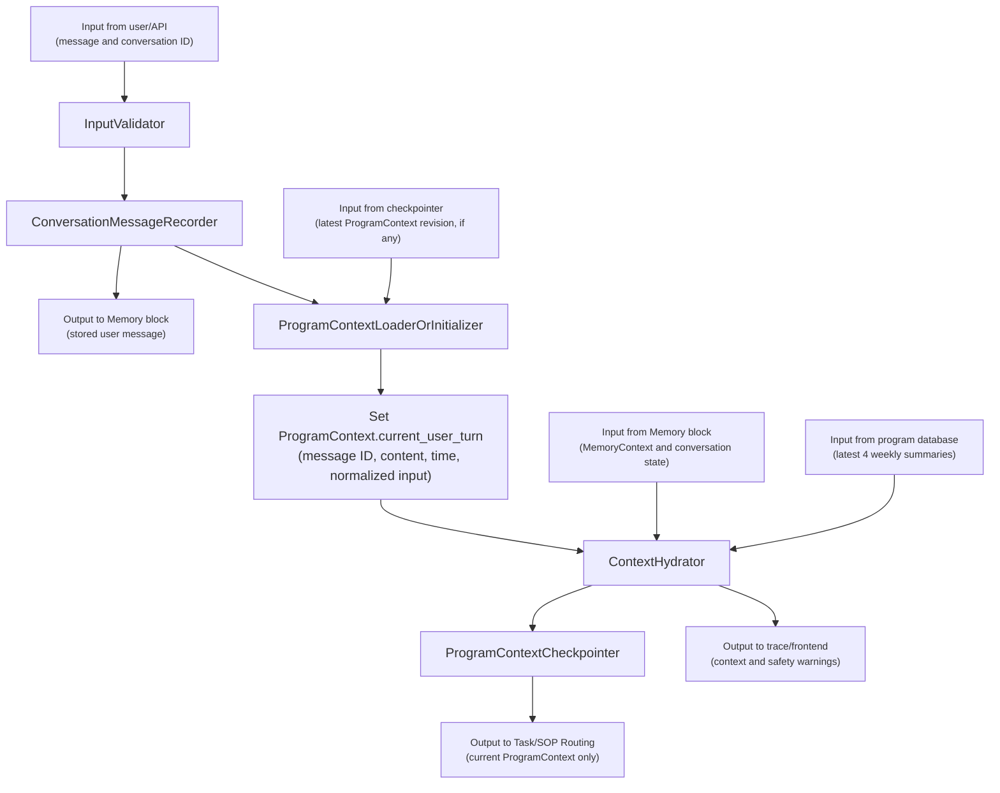
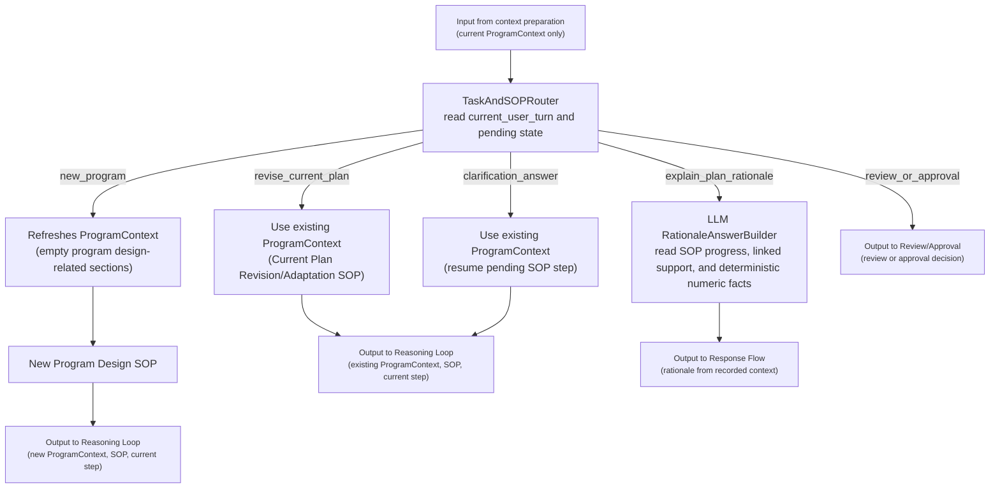
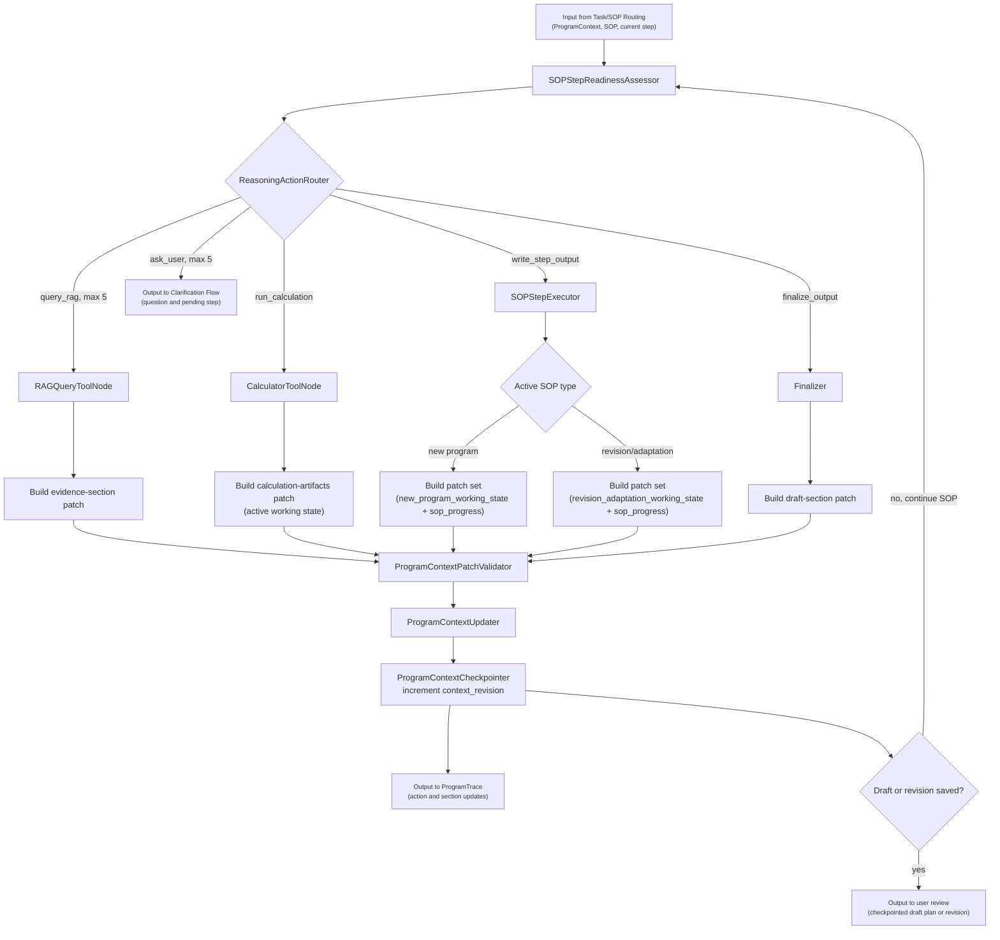
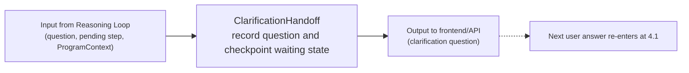
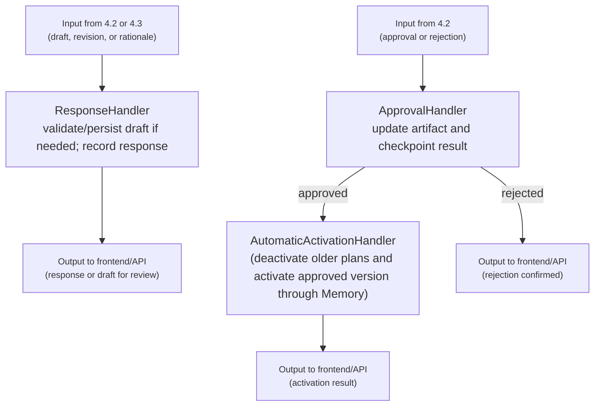

# Program Generator Development Outline

## 1. Purpose And Scope

The Program Generator is the planning and adaptation block of the AI trainer. Its job is to use direct user feedback, training summaries, user memory, approved evidence, and deterministic calculation tools to create, review, and adapt training programs, then hand approved plans to the User Profile And Memory block.

Core responsibilities:

- Keep natural-week training-level summary notes and retrieve the latest 4 natural weeks for program generation and adaptation.
- Generate professional training plans from user-provided information, the User Profile And Memory block, training summaries, direct readiness/recovery feedback, active plan state, and approved evidence retrieved from the Evidence-Based Q&A Assistant.
- Explain the rationale behind generated or adapted plans with rationale recorded during plan generation and adaption.
- Ask the user for missing raw information when the current context is insufficient, such as goals, schedule, current training level, available equipment, readiness, pain, or recent performance.
- Maintain one checkpointed `ProgramContext` for each open Program Generator conversation and update the corresponding context sections after every user turn, tool result, and completed SOP step.
- Record every user and assistant message through the User Profile And Memory block; when the conversation closes, let the Memory block create an `Episode` using the same conversation lifecycle used by the Q&A Assistant.
- Use a LangGraph reasoning-and-actioning loop that can decide whether to query RAG, ask the user, run deterministic calculation tools, or produce a plan step.
- Pre-calculate every numeric strength-plan prescription through deterministic tools, including weights, sets, reps, rest times, session durations, intensities, volume totals, and progression increments.
- Save generated or revised plans as draft plan versions, send approved versions to the Memory block for activation and progress tracking, and write approved plans to Xunji when configured.
- Adapt the remaining plan when the user misses or cannot complete a planned session because of schedule conflicts, sickness, poor sleep, insufficient recovery, insufficient training level, pain, or other feedback.
- Expose generation, review, adaptation, calculator, summary, and trace capabilities through backend APIs and MCP tools.

Out of scope for this block:

- Evidence corpus upload, approval, chunking, indexing, and retrieval internals.
- Long-term user profile memory, episodic conversation memory, and recent-status memory internals.
- Diagnosing medical conditions, prescribing treatment, or clearing users for exercise when medical review is required.
- Wearable, calendar, or external app integrations except for optional Xunji write-back after explicit user approval.

Boundary rule for v1:

- This block owns training summary notes, program drafts, program versions, session prescriptions, adaptation records, calculation traces, and program traces.
- This block owns the conversation-scoped `ProgramContext` and its checkpoints. `ProgramContext` is working state for generation and revision/adaptation; rationale explanations read that recorded state without creating separate workflow state.
- The User Profile And Memory block owns profile facts, recent status, conversation messages, rolling conversation summaries, episodes, the approved active plan and progress, and imported historical log retrieval. This block consumes those through stable APIs or MCP tools, records Program Generator messages there, and writes approved training plans back there for activation.
- The Evidence-Based Q&A Assistant owns approved evidence and RAG retrieval. This block consumes it through `search_knowledge` or `ask_qa_assistant`; it must not read the knowledge database directly.

## 2. Technical Stack And Fixed V1 Choices

Use these choices for v1 unless the project owner explicitly changes them before implementation.

### Runtime And Package Baseline

- Language: Python 3.11.
- API server: `FastAPI`.
- UI: `Streamlit`.
- Agent graph: `LangGraph`.
- Metadata ORM: `SQLModel` on top of SQLite.
- MCP: Python MCP SDK with `FastMCP`.
- Test runner: `pytest`.
- Environment config: `.env` loaded with `pydantic-settings`.
- LLM provider: reuse the app provider adapter already used by Q&A and memory.

### Frontend

- Stack: `Streamlit`.
- Required tab: a dedicated `Program Generator` tab.
- The `Program Generator` tab should be separate from the existing `Training Log` and `Memory` tabs.
- Rule: the UI stays thin and calls backend APIs. It should not own plan logic, calculation logic, RAG logic, or adaptation policy.

### Backend API

- Stack: `FastAPI` with `Pydantic` request and response models.
- Purpose: expose stable HTTP endpoints for Streamlit, MCP tools, and future integrations.
- Rule: all core logic lives in service classes, graph nodes, and calculator helpers.
- Rule: after explicit approval, this block automatically activates the complete approved plan through the User Profile And Memory block, which remains the canonical active-plan and progress owner. Activation atomically deactivates any older active plan for the user before making the approved version the sole active plan.

### Agent Orchestration

- Stack: `LangGraph`.
- Main graph: one `ProgramGeneratorGraph` for program generation, program review, summary-aware context preparation, and adaptation.
- Graph style: reasoning and actioning, similar to a ReAct loop but with typed state, explicit actions, counters, and deterministic validators.
- Allowed graph actions:
  - `query_rag`
  - `ask_user`
  - `run_calculation`
  - `write_step_output`
  - `finalize_output`
- Loop limit:
  - At most 5 RAG queries per SOP step.
  - At most 5 user clarification questions per SOP step.
  - Calculation tool calls are not counted as RAG or user questions, but every calculation must be logged.
- If the graph reaches either query limit, it must send a warning to the user through frontend and produce the best safe output for the current question or current SOP step, with explicit assumptions, missing inputs, and safety limits.

### LLM And Evidence Use

- Chat model: use latest and strongest OpenAI GPT model.
- Evidence retrieval: call the Q&A block through MCP.
- Memory retrieval: call the User Profile And Memory block through MCP.
- Rule: the generator may use LLM reasoning to decide what to ask or query next, but evidence claims in the final plan rationale must be tied to retrieved sources.

### Metadata Database

Use SQLite with `SQLModel` at `data/app.sqlite`.

Required tables for v1:

- `training_summary_notes`
- `program_contexts`
- `program_requests`
- `training_programs`
- `program_versions`
- `program_sessions`
- `exercise_prescriptions`
- `set_prescriptions`
- `program_adaptations`
- `program_traces`
- `program_tool_calls`
- `calculation_traces`
- `program_citations`
- `program_safety_flags`

## 3. Configuration Defaults

All runtime choices should be configurable through environment variables and loaded into the existing typed settings object.

```text
PROGRAM_MAX_RAG_QUERIES=5
PROGRAM_MAX_USER_QUESTIONS=5
PROGRAM_MAX_SOP_STEPS_PER_RUN=12
PROGRAM_MAX_CONTEXT_TOKENS=66000
PROGRAM_CHECKPOINT_AFTER_EACH_CONTEXT_UPDATE=true
PROGRAM_EVIDENCE_CONTEXT_TOP_K=12
PROGRAM_DEFAULT_UNITS=metric

PROGRAM_BARBELL_LOAD_ROUNDING_KG=0.5
PROGRAM_DUMBBELL_LOAD_ROUNDING_KG=2.0
PROGRAM_MACHINE_LOAD_ROUNDING_KG=2.5
PROGRAM_BODYWEIGHT_LOAD_ROUNDING_KG=0.5
PROGRAM_REST_ROUNDING_SECONDS=5
PROGRAM_DURATION_ROUNDING_SECONDS=60

PROGRAM_REQUIRE_APPROVAL_BEFORE_ACTIVATION=true
PROGRAM_REQUIRE_APPROVAL_BEFORE_XUNJI_WRITE=true
PROGRAM_XUNJI_WRITE_ENABLED=false
```

If no LLM API key is configured, the app should still start. Program-generation endpoints should return a clear configuration error. Calculator endpoints should continue to work without an LLM key.

## 4. Main Data Pipeline Diagrams

The Program Generator is conversation-oriented. One open Program Generator conversation has one maintained `ProgramContext`.

In the diagrams, handoff blocks use plain `Input from...` and `Output to...` labels, with the actual data or action on a lighter second line.

### 4.1 Conversation Turn And ProgramContext Start Or Resume

Inputs:


| Input                                              | From                                    |
| -------------------------------------------------- | --------------------------------------- |
| User message and conversation ID                   | `Program Generator` tab or program API  |
| Open conversation and recent messages              | User Profile And Memory block           |
| Existing `ProgramContext` checkpoint, when present | Program Generator database/checkpointer |
| Task-profiled `MemoryContext`                      | User Profile And Memory block           |
| Latest 4 completed natural-week summary notes      | Program Generator database              |


Outputs:


| Output                                                                 | To                                     |
| ---------------------------------------------------------------------- | -------------------------------------- |
| Stored user `ConversationMessage`                                      | User Profile And Memory block          |
| Initialized or resumed `ProgramContext` containing `current_user_turn` | `Task And SOP Routing`                 |
| Context and safety warnings                                            | Reasoning loop and frontend trace view |





On resume, `ContextHydrator` refreshes `memory_context` while preserving the weekly summaries and conversation's mutable SOP progress, evidence, calculation, draft, and approval sections. The canonical user message remains in the Memory block; `ProgramContext.current_user_turn` stores the message reference and working copy required by the generator.

### 4.2 Task And SOP Routing

Inputs:


| Input                    | From                                                   |
| ------------------------ | ------------------------------------------------------ |
| Current `ProgramContext` | `Conversation Turn And ProgramContext Start Or Resume` |


Outputs:


| Output                                                       | To                                              |
| ------------------------------------------------------------ | ----------------------------------------------- |
| New `ProgramContext` with New Program Design SOP             | `Reasoning, Actioning, And Context Update Loop` |
| Existing `ProgramContext` with revision or resumed SOP state | `Reasoning, Actioning, And Context Update Loop` |
| Review or approval route                                     | `Draft Review, Approval, And Response`          |
| Plan-rationale response                                      | `Draft Review, Approval, And Response`          |





The LLM-backed `TaskAndSOPRouter` reads `current_user_turn`, `active_task_type`, `active_sop`, `current_sop_step`, active-version/approval state, and pending clarification state from the current ProgramContext. It returns one validated route plus a short rationale and confidence. The route is selected once per user turn and locked during the reasoning/action loop. A new-plan request refreshes the existing ProgramContext (empty some program design related sections including `retrieved_evidence`, `sop_progress,` Active task working state, and `draft_artifacts`) before entering the New Program Design SOP. Revision and clarification-answer routes retain and update the existing ProgramContext. `explain_plan_rationale` creates no context: deterministic code selects any relevant prescription and calculation-chain facts, then the LLM `RationaleAnswerBuilder` tailors an explanation from those facts and the existing SOP progress/context.

### 4.3 Reasoning, Actioning, And Context Update Loop

Inputs:


| Input                                                       | From                         |
| ----------------------------------------------------------- | ---------------------------- |
| Maintained `ProgramContext`, selected SOP, and current step | `Task And SOP Routing`       |
| RAG results                                                 | Evidence-Based Q&A Assistant |
| Calculation results                                         | Calculator MCP tools         |
| Clarification answers                                       | `Task And SOP Routing`       |


Outputs:


| Output                                 | To                                    |
| -------------------------------------- | ------------------------------------- |
| Checkpointed `ProgramContext` revision | Next loop iteration or next user turn |
| User clarification request             | `Clarification Handoff`               |
| Draft plan or revision                 | `Response And Approval`               |
| Action and context-update trace        | Program trace storage                 |





Every action returns one typed `ProgramContextPatch` or a validated patch set. `SOPStepExecutor` returns a patch set containing one update for the corresponding working-state section and one update for `sop_progress`. Each individual patch may update only its declared section. No patch may overwrite read-only `MemoryContext` data, weekly summaries, prior calculation traces, or prior evidence records.

For the New Program Design SOP, step outputs populate fields such as health screening, needs analysis, periodization, planning model, programming decisions, and prescriptions in `sop_progress.decisions` and `new_program_working_state`. For the Current Program Revision And Adaptation SOP, they populate protected goals, impact analysis, affected variables, proposed changes, and changed/unchanged elements in `sop_progress.decisions` and `revision_adaptation_working_state`.

`Finalizer` runs only after the selected SOP is complete. It has one path: build the draft/revision patch, validate and apply it, checkpoint the updated ProgramContext, and then send that saved draft to user review.

The ReasoningActionRouter and the SOPStepReadinessAssessor should know about the limit on RAG queries and user clarification questions. They should also monitor the used chances of RAG queries and user clarification questions in the current SOP step for making better decisions.

### 4.4 Clarification Handoff

Inputs:


| Input                                                                  | From                                            |
| ---------------------------------------------------------------------- | ----------------------------------------------- |
| Clarification question, pending SOP step, and current `ProgramContext` | `Reasoning, Actioning, And Context Update Loop` |


Outputs:


| Output                                                      | To                                              |
| ----------------------------------------------------------- | ----------------------------------------------- |
| Stored assistant question and `waiting_for_user` checkpoint | Memory block and Program Generator checkpointer |
| Clarification question                                      | Frontend/API                                    |





Section 4.4 does not process the answer. The next user answer follows the normal 4.1 flow, where it is recorded and added to the current ProgramContext; section 4.2 then resumes the pending SOP step.

### 4.5 Response And Approval

Inputs:


| Input                                           | From                |
| ----------------------------------------------- | ------------------- |
| Checkpointed draft/revision or rationale answer | Sections 4.3 or 4.2 |
| Approval or rejection route                     | Section 4.2         |


Outputs:


| Output                                 | To                             |
| -------------------------------------- | ------------------------------ |
| Recorded assistant response            | Memory block and frontend/API  |
| Automatic activation result            | Program Generator and frontend |
| Checkpointed approval/rejection result | Program Generator checkpointer |





`AutomaticActivationHandler` sends the user ID and complete approved program/version to Memory. Memory atomically returns the activated plan/version IDs and any deactivated plan IDs. If activation fails, no active-plan change is committed; the approved version remains retryable and the response reports `activation_failed`.

Requested changes do not need another branch here. They return as a normal user turn through 4.1, and section 4.2 routes the existing ProgramContext to the Revision/Adaptation SOP. All assistant outputs are recorded with `source_block=program_generator`.

Conversation closing follows the conversation-closure process defined in the User Profile And Memory outline. When closing a conversation that has a ProgramContext, the complete ProgramContext remains in the Program Generator database for audit and is referenced, not copied, by the Episode.

If the original planning/adaption conversation is closed and the user opens a new conversation to revise or explain the active plan, the corresponding ProgramContext will be retrieved from the Program Generator database.

## 5. ProgramContext And Weekly Summaries

Sections 1-4 define the runtime behavior. This section only defines the state shape and limits needed to implement it.

### 5.1 ProgramContext And Token Budget

A new-plan route creates a new `ProgramContext`; revision and clarification routes resume the existing one. `explain_plan_rationale` reads the existing context without creating or modifying planning state.

Lifecycle metadata is structural and is not part of the prompt budget:

```text
context_id, parent_context_id, user_id, conversation_id, context_revision
status, active_task_type, current_turn_route, active_sop, current_sop_step, pending_action
latest_program_id, latest_version_id, review_status, approval_status
created_at, updated_at, closed_at
```

Both `program_generation` and `program_adaptation` request `plan_context_level=full`.


| ProgramContext section             | Content and ownership                                                                                                                                                                                                                                                                                                                                                                                             | Token cap |
| ---------------------------------- | ----------------------------------------------------------------------------------------------------------------------------------------------------------------------------------------------------------------------------------------------------------------------------------------------------------------------------------------------------------------------------------------------------------------- | --------- |
| `current_user_turn`                | Current user message and normalized input                                                                                                                                                                                                                                                                                                                                                                         | 1000      |
| `memory_context`                   | Compact read-only copy of the Memory block context: section text, memory IDs, trace ID, token estimate, and budget warnings. `rendered_context` and debug metadata are not checkpointed in ProgramContext; prompt text is rendered from the stored sections when needed. The Memory block API remains unchanged.                                                                                                  | 34000     |
| `latest_four_week_summary_notes`   | Read-only Program Generator summaries                                                                                                                                                                                                                                                                                                                                                                             | 2000      |
| `retrieved_evidence`               | Full retrieved evidence for the current SOP step only, stored as `{current_step, items}`. Historical step-to-evidence mapping lives compactly in `sop_progress.evidence_refs_by_step`; full audit rows remain in `ProgramTrace`, `ProgramToolCall`, `ProgramCitation`, and the knowledge store.                                                                                                                   | 6000      |
| `user_clarification_answers`       | Append-preserving user answers                                                                                                                                                                                                                                                                                                                                                                                    | 2000      |
| `sop_progress`                     | Current step, completed steps, decisions, rationale, and linked support                                                                                                                                                                                                                                                                                                                                           | 2000      |
| Active task working state          | `new_program_working_state` or `revision_adaptation_working_state`, used by the program generator agent for brain stomming and recording SOP decisions. Keep the LLM `raw_plan` as the high-level template and store deterministic expansion as `calculation_artifacts` (`calculated_sessions` plus `calculated_periodization`); derive the full calculated plan only when finalizing or serving a review object. | 10000     |
| `draft_artifacts`                  | Draft output IDs required by the frontend review flow                                                                                                                                                                                                                                                                                                                                                             | 5000      |
| `safety_flags_and_budget_warnings` | Blocking or limiting conditions                                                                                                                                                                                                                                                                                                                                                                                   | 1000      |
| **Planned maximum**                | `PROGRAM_MAX_CONTEXT_TOKENS=66000`                                                                                                                                                                                                                                                                                                                                                                                | **66000** |


Each accepted patch updates only its declared section, increments `context_revision`, and is checkpointed. Evidence, answers, and traces may be superseded with a reason but must not be silently overwritten. Full calculation audit stays in `CalculationTrace` rows and prescription-specific trace links, not in ProgramContext sections. Memory-owned data is never patched by this block.

The Memory outline owns the internal `MemoryContext` section caps. These caps are maxima, not targets. Before every LLM call, count the assembled prompt. If it exceeds 66000 tokens, pause, send a warining to the user through frontend, mentioen all sections exceeding their limit and let the user decide if the generation process should continue or stop and close the conversation; never silently remove protected plan details, safety information, provenance, or calculation traces.

### 5.2 Weekly Summary Notes

- A scheduled routine creates one summary of at most 400 tokens each Sunday in the user's timezone.
- Use the natural week Monday-Sunday and keep completed weeks stable.
- Context preparation reads the latest four completed weeks; it never creates or refreshes them inline.
- Missing weeks produce a warning, not an inline backfill.
- Each note covers adherence, training emphasis, volume/intensity, recovery/safety, performance, plan changes, and source IDs.

## 6. SOPs

The reasoning loop may pause any SOP step to retrieve evidence, ask the user, or calculate values. It advances only when `SOPStepReadinessAssessor` marks the current step ready.

### 6.1 New Program Design

1. **Consultation and health screening:** collect health, injury/pain, lifestyle, readiness, medication changes, and relevant history; require clearance when risk is elevated.
2. **Needs analysis:** define goal/sport demands, training status, constraints, schedule, equipment, movement needs, and limiting factors.
3. **Periodization:** establish the macrocycle, mesocycles, microcycles, phases, and target timeline.
4. **Planning model:** choose `parallel`, `sequential`, or `emphasis` and record why.
5. **Programming decisions - Exercises and Order:** based on needs analysis and retrieved knowledges, choose exercises, their training frequency, and decide their order in a session.
6. **Programming decisions - Intensity and Volumn:** based on needs analysis and retrieved knowledges, for each planned exercises, choose their intensities, repetitions, loading patterns, set types, and session types.
7. **Load calculation:** calculate `load_kg` for each exercise in each session.
  Every exercise must be classified as `weighted` or `bodyweight`. A weighted exercise requires an available 1RM record or recent weight-and-repetition record for that exercise in Memory, or a current user-provided 1RM. If no valid load reference exists in the memory, ask the user for that raw performance input and estimate the exercise 1RM with a deterministic calculator before calculating every `load_kg`. Only bodyweight exercises may retain `load_kg=null`.
8. **Volume calculation:** calculate session and week workload in suitable units.
9. **Rest periods:** calculate recovery intervals after intensity and volume are known.

### 6.2 Current Plan Revision Or Adaptation

1. **Trigger classification**: Classify the trigger: goal, schedule, equipment, preference, performance, difficulty, recovery, pain/safety, or missed session.
2. **Load existing plan**: Use the full active plan/version and progress shown in the "`active_plan_progress`" section of the memory context as the baseline, do not mutate the Memory-owned active plan before approval.
3. **Identify Constraints**: Identify protected goals, safety constraints, timeline, emphases, and unaffected elements.
4. **Assess Impact**: Analyze effects of the potential revision/adaption on future sessions, evidence-backed decisions, and progress links.
5. **Select Revision**: Choose the smallest coherent change according to the current progress of the plan to be revised, the trigger and retrieved knowledge.
6. **Recalculation**: Recalculate every affected number.
7. **Draft Plan Update**: Create a new draft version listing changed and unchanged elements, rationale behind and calculations.

## 7. Output And Validation Rules

- Red-flag symptoms or elevated medical risk stop normal planning and return an appropriate clearance/professional-care recommendation.
- Every visible prescription must contain concrete values when inputs are available and reference its calculation trace. Ask for raw inputs, never user-computed values.
- If a value must be assumed after query limits are reached, use a conservative explicit assumption.
- Evidence claims require citations; user-specific decisions require user, Memory, log, or summary source IDs.
- Drafts remain `draft` or `draft_adaptation` until user approval. Approval automatically triggers the activation transaction above; Memory stores the sole active plan and tracks its progress.
- `explain_plan_rationale` reads `sop_progress` and linked evidence/calculations; it creates no SOP, context profile, or plan version.
- Xunji write-back requires both configuration enablement and separate approval for that write.

A draft is reviewable only when safety checks pass, all required plan fields exist, all visible numbers are traced, and assumptions/warnings are shown.

## 8. Persistence Model

Section 2 lists the required SQL tables. Their relationships are stated from the child record's perspective so the direction is unambiguous:


| Relationship                                 | Child rule                                                                                                           | Parent rule                                                       | Foreign key                                         |
| -------------------------------------------- | -------------------------------------------------------------------------------------------------------------------- | ----------------------------------------------------------------- | --------------------------------------------------- |
| `ProgramRequest` to `ProgramContext`         | Every request belongs to exactly one context                                                                         | One context may have zero or many requests                        | Required `ProgramRequest.context_id`                |
| `ProgramVersion` to `TrainingProgram`        | Every version belongs to exactly one program                                                                         | One program may have zero or many versions                        | Required `ProgramVersion.program_id`                |
| `ProgramSession` to `ProgramVersion`         | Every session belongs to exactly one version                                                                         | One version may have zero or many sessions                        | Required `ProgramSession.version_id`                |
| `ExercisePrescription` to `ProgramSession`   | Every exercise prescription belongs to exactly one session                                                           | One session may have zero or many exercise prescriptions          | Required `ExercisePrescription.session_id`          |
| `SetPrescription` to `ExercisePrescription`  | Every set prescription belongs to exactly one exercise prescription                                                  | One exercise prescription may have zero or many set prescriptions | Required `SetPrescription.exercise_prescription_id` |
| `ProgramAdaptation` to its source version    | Every adaptation has exactly one original version                                                                    | One version may be the source of zero or many adaptations         | Required `ProgramAdaptation.from_version_id`        |
| `ProgramAdaptation` to its resulting version | Every adaptation has exactly one resulting version                                                                   | One version may be the result of zero or one adaptation           | Required, unique `ProgramAdaptation.to_version_id`  |
| `ProgramTrace` to `ProgramContext`           | Every trace belongs to exactly one context                                                                           | One context may have zero or many traces                          | Required `ProgramTrace.context_id`                  |
| `ProgramTrace` to `ProgramVersion`           | A trace references zero or one version                                                                               | One version may be referenced by zero or many traces              | Nullable `ProgramTrace.version_id`                  |
| Trace child records to `ProgramTrace`        | Every `ProgramToolCall`, `CalculationTrace`, `ProgramCitation`, and `ProgramSafetyFlag` belongs to exactly one trace | One trace may have zero or many records of each type              | Required `trace_id` on each child record            |


| Object                                     | Essential fields                                                                                                       |
| ------------------------------------------ | ---------------------------------------------------------------------------------------------------------------------- |
| `ProgramContextRecord`                     | IDs, parent context, conversation, revision, status, active SOP/step, serialized sections, timestamps                  |
| `ProgramRequest`                           | IDs, context/conversation, request type, raw request, goal/constraints, status, timestamps                             |
| `TrainingProgram`                          | ID, user, title/goal/sport, generation status, latest version                                                          |
| `ProgramVersion`                           | ID, program/version number, status/reason, screening, needs analysis, periodization, planning model, rationale         |
| `ProgramSession`                           | ID, version, planned date/microcycle, type/goal, duration, exercise order                                              |
| `ExercisePrescription` / `SetPrescription` | Ordered exercise and complete numeric prescription fields with calculation trace IDs                                   |
| `ProgramAdaptation`                        | From/to versions, trigger, user feedback, changed/unchanged elements, evidence/calculation references, approval status |
| `ProgramTrace`                             | Context revision, task/SOP step, ordered actions, source IDs, counters, warnings/errors, latency                       |
| `CalculationTrace`                         | Tool/formula, inputs, result, units, rounding, source references                                                       |
| `TrainingSummaryNote`                      | User/week/timezone, <=400-token summary, source IDs, created time                                                      |


`ProgramContextPatch` is a Pydantic command object, not a table. It contains the expected context revision, target section, operation, value, source/trace references, and supersession reason when applicable.

Program artifact status in this database describes generation/review only. Active-plan state and session progress remain canonical in the Memory block.

## 9. Implementation Contracts

Sections 4.1-4.5 are the authoritative graph. Implement their labels as small typed nodes or deterministic services.


| Component                            | Contract                                                                                                                                                                 |
| ------------------------------------ | ------------------------------------------------------------------------------------------------------------------------------------------------------------------------ |
| `TaskAndSOPRouter`                   | Use structured LLM output over the current ProgramContext to select a validated route once per turn; reuse the locked route during revision/resume and reasoning actions |
| `SOPStepReadinessAssessor`           | Return ready/not-ready or missing inputs                                                                                                                                 |
| `ReasoningActionRouter`              | Based on the outputs of `SOPStepReadinessAssessor`, choose RAG, user clarification, calculation, step output, or finalization                                            |
| `SOPStepExecutor`                    | Produce a working-state patch and an SOP-progress patch for the active SOP                                                                                               |
| `RAGQueryToolNode`                   | Retrieve approved evidence                                                                                                                                               |
| `CalculatorToolNode`                 | Run deterministic calculators and return traceable outputs                                                                                                               |
| Patch validator/updater/checkpointer | Validate section ownership, apply patches atomically, and persist the incremented context revision                                                                       |
| `Finalizer`                          | Build the draft-artifact patch only after the SOP is complete                                                                                                            |
| `RationaleAnswerBuilder`             | Use an LLM to tailor an answer from recorded SOP context and deterministically selected numeric facts without changing planning state                                    |
| Response/approval handlers           | Record output, persist drafts, process review, and automatically run the Memory activation/deactivation transaction after approval                                       |
| `ProgramTraceLogger`                 | Record actions, context revisions, source IDs, calculations, warnings, errors, and timings                                                                               |


Keep transient graph state small:

```text
program_context
pending_patch_or_patch_set
next_action
last_tool_result
interrupt_payload
errors
timings
```

Do not duplicate ProgramContext sections as top-level graph fields. Prompt text belongs in prompt files; formulas belong in deterministic calculator code; database models and API schemas remain separate.

## 10. Interfaces

### MCP Tools

Use `FastMCP` to expose thin, typed wrappers over existing backend services. MCP tools must not duplicate graph, retrieval, memory, formula, approval, or persistence logic.

#### Program Tools

- `send_program_conversation_turn`
- `get_program_context`
- `get_program_version`
- `review_training_program`
- `get_program_trace`
- `write_training_program_to_xunji`

`review_training_program` accepts `approve` or `reject`. A request for changes is sent through `send_program_conversation_turn` so it re-enters section 4.1 and follows the revision flow. Xunji write-back is a separate tool call and requires a separately confirmed approval.

#### Calculator Tools

- `calculate_expression`
- `estimate_repetition_max`
- `calculate_percentage_load`
- `round_training_load`
- `calculate_volume_load`
- `calculate_session_duration`
- `calculate_rest_interval`
- `calculate_weekly_frequency`
- `calculate_progression_increment`

Every calculated numeric prescription in a generated or adapted plan must be created or validated by deterministic calculator tools. The LLM may request raw inputs from the user, but it must not ask the user to calculate 1RM, percentages, loads, rest times, session durations, or weekly volume.

Each calculated value must record its value, unit, inputs and their sources, formula or method, rounding policy, tool name, and tool-call ID. Calculator MCP tools and calculator HTTP endpoints must call the same backend calculator service.

#### External Block Tools

The Program Generator uses these MCP tools owned by other blocks:

- Evidence-Based Q&A Assistant: `search_knowledge`, `ask_qa_assistant`
- User Profile And Memory: `get_user_memory_context`

### FastAPI

- `POST /api/programs/conversations/{conversation_id}/turns`: process one user turn through sections 4.1-4.5.
- `GET /api/programs/contexts/{context_id}`: return context status, SOP progress, draft references, and warnings.
- `POST /api/programs/{program_id}/versions/{version_id}/review`: approve and automatically activate the version through Memory, or reject it with a reason.
- `POST /api/programs/{program_id}/versions/{version_id}/xunji-write`: write an approved version to Xunji after separate confirmation.
- `GET /api/programs/{program_id}/versions/{version_id}`: return a generated version.
- `GET /api/programs/traces/{trace_id}`: return the complete trace.
- `GET /api/training/summary-notes`: return the latest completed weekly notes.
- `POST /api/programs/calculators/{tool_name}`: run a deterministic calculator.

FastAPI endpoints and MCP tools call the same services and use these shared Pydantic contracts:


| Contract                                          | Required content                                                                                        |
| ------------------------------------------------- | ------------------------------------------------------------------------------------------------------- |
| `ProgramTurnRequest` / `ProgramTurnResponse`      | User message; context ID/revision, route, response or draft reference, pending action, and warnings     |
| `ProgramContextResponse`                          | Context metadata, SOP progress, draft references, and warnings                                          |
| `ProgramVersionResponse`                          | Complete generated version and review status                                                            |
| `ProgramReviewRequest` / `ProgramReviewResponse`  | `approve` or `reject`, optional reason, expected version; resulting status and Memory activation result |
| `XunjiWriteRequest` / `XunjiWriteResponse`        | Separate confirmation; write status, external IDs, and errors                                           |
| `ProgramTraceResponse`                            | Complete program trace                                                                                  |
| `TrainingSummaryNotesResponse`                    | Requested completed-week notes and warnings                                                             |
| Calculator-specific request / `CalculationResult` | Typed inputs; value, unit, method, rounding, tool-call ID, and input sources                            |


Conversation creation/message storage/closure and active-plan progress use the Memory APIs. The Program Generator must not expose competing active-plan or progress endpoints.

## 11. Frontend

The dedicated `Program Generator` tab should provide:

- A conversation view for new-plan, revision, clarification, and rationale turns.
- The Memory-owned active-plan summary.
- Current SOP progress and waiting state.
- Draft/revision review with approve, reject, and request-change actions.
- Evidence, calculation, safety, warning, and trace details.
- Optional separately approved Xunji write-back.

The UI calls backend APIs and contains no planning, calculation, evidence, or adaptation logic.

## 12. Tests And Assumptions

Minimum tests:

- New-plan routing creates a new ProgramContext; revision and clarification resume the existing context.
- Each accepted patch updates only allowed sections, increments `context_revision`, and survives interruption/resume.
- New-program and revision/adaptation SOP order is enforced.
- RAG and user-question limits never exceed five per SOP steps.
- Clarification answers re-enter through section 4.1 and resume the pending step.
- Rationale explanations are read-only; an LLM uses recorded SOP support while numeric inputs remain grounded in persisted calculator traces.
- Every visible numeric prescription has a valid calculation trace.
- Red flags block normal planning; missing evidence and assumptions are disclosed.
- Missed-session routing distinguishes schedule conflict from recovery limitation and preserves adjustment priority.
- Drafts cannot activate without approval; activation and progress ownership remain in Memory.
- Conversation closure follows the Memory outline and the Episode references, rather than copies, ProgramContext.
- API and MCP responses follow the same service contracts.

V1 assumptions: one local user, Python 3.11, SQLite/SQLModel, optional Chroma in Memory, optional Xunji write-back, and no implementation or migration work required by this planning document. Prefer explicit schemas, deterministic calculations, user review, and inspectable traces.