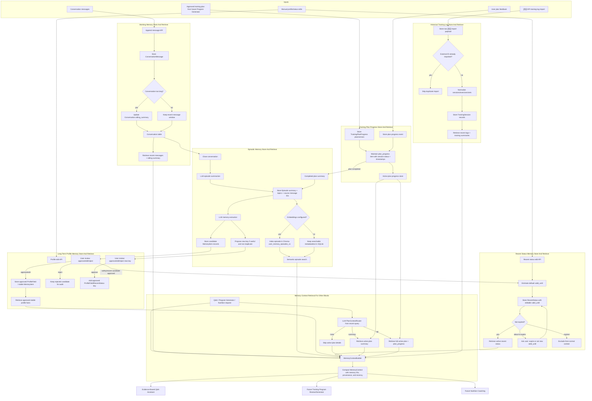

# User Profile And Memory System Development Outline

## 1. Purpose And Scope

The User Profile And Memory block is the personalization layer for the AI personal trainer. V1 should stay local-first, inspectable, and feasible: it should store conversation context, episodic conversation memory, stable user profile facts, recent user status, active plan progress, and imported historical training logs.

Core responsibilities:

- Maintain working memory for each conversation: recent messages plus rolling summary.
- Convert completed conversations into permanent episodic memories.
- Maintain long-term user profile memory: goals, preferences, stable constraints, provided demographics, equipment, schedule, and performance notes.
- Maintain recent status memory: sleep, soreness, pain, illness, stress, availability, readiness, and other short-lived state.
- Maintain basic training plan progress: active plan ID, plan version, planned sessions, completed/missed/adapted sessions, completion timestamps, and feedback; retrieve full details only when plan context is relevant.
- Maintain historical training logs imported from `训记` API only in v1.
- Retrieve a compact `MemoryContext` for Q&A, future program generation, and nutrition coaching.

Out of scope for v1:

- Training plan generation.
- Meal plan generation.
- Wearable/calendar integrations.
- Fully automatic safety-relevant memory updates without review.
- Making Mem0 the canonical memory database.

## 2. Technical Stack And Fixed V1 Choices

- Runtime: Python 3.11.
- Backend: `FastAPI`.
- UI: `Streamlit`.
- Database: `SQLModel` with SQLite at `data/app.sqlite`.
- Agent workflow: `LangGraph` for memory extraction and context assembly.
- Vector search: local `Chroma` collection `user_memory_episodes_v1` for episodic semantic search.
- Keyword/metadata search: SQLite queries, optionally SQLite FTS5 for episode text.
- LLM provider: reuse the existing provider adapter from the Q&A block.
- MCP: Python MCP SDK / `FastMCP`.

V1 rule: SQL tables are the source of truth. Chroma is only an index for searching episode summaries.

## 3. Main Data Pipeline Diagram



## 4. Store And Retrieve Rules By Memory Type

| Memory type | Store process | Retrieve process | Canonical store |
|---|---|---|---|
| Working memory | Save every message under `conversation_id`; update rolling summary when long | Recent messages + rolling summary | `Conversation`, `ConversationMessage` |
| Episodic memory | On conversation close or plan completion, summarize the conversation/plan and optionally embed summary | Semantic search over episodes plus metadata filters | `Episode` table; Chroma as search index |
| Long-term profile | Manual edit or approved extracted candidate; proposed new keys require user approval before joining the key catalog | Approved non-expired profile facts by user and category | `ProfileField`, stable `MemoryItem`, `MemoryKeyProposal` |
| Recent status | Manual edit or approved candidate with `observed_at` and an estimated editable `valid_until` | Active non-expired statuses only; near-expiry statuses prompt the user to expire or renew them | `RecentStatus`, `MemoryKeyProposal` |
| Plan progress | Store approved plan version, a current `plan_progress` item, and append-only progress events | Conditional retrieval by `plan_context_level`: none, summary, or full active plan with per-session status and timestamps | `TrainingPlanProgress` |
| Historical logs | Import from `训记`; store raw payload; normalize sessions | Recent sessions, weekly/monthly summaries, exercise history | `TrainingLogImport`, `TrainingSession` |

## 5. Core Data Objects

- `UserAccount`: `user_id`, display name, timezone, created time.
- `Conversation`: `conversation_id`, `user_id`, status, topic/title, rolling summary, closure reason, timestamps.
- `ConversationMessage`: role, content, source block, optional Q&A trace ID, timestamp.
- `Episode`: summary, topics, importance, source message IDs, time range, embedding ID.
- `MemoryItem`: category, text summary, `value_json`, confidence, source IDs, status, timestamps, expiry, replacement link.
- `ProfileField`: stable user fact name, value, source, review status, updated time.
- `RecentStatus`: status type, value, severity/impact, `observed_at`, estimated editable `valid_until`, review status, expiration reminder status.
- `MemoryKeyProposal`: proposed `ProfileField` or `RecentStatus` key, example value, reason, nearest existing keys checked, duplicate/equivalence decision, source memory/message IDs, review status.
- `TrainingPlanProgress`: plan ID, version, status, planned sessions, current `plan_progress` item, progress events, feedback. The `plan_progress` item records the current state of the plan, including whether each planned session is pending, completed, missed, or adapted, plus timestamps such as `completed_at`. When the plan is completed, save a plan-completion `Episode` for future retrieval.
- `TrainingLogImport`: provider, external ID, raw payload, checksum, import time.
- `TrainingSession`: normalized date, sport type, exercises/sets summary, RPE, notes, source import ID.

### Key Object And Pipeline Notes

- `Append message API`: the endpoint that records each user or assistant turn as a `ConversationMessage` under a `conversation_id`. It stores raw conversation history for working memory and later summarization; it should not decide long-term memory by itself.
- `Conversation` table: the thread-level record for a conversation. It stores status, topic/title, timestamps, and `rolling_summary`; individual turns live in `ConversationMessage`.
- `LLM memory extraction`: reads conversation messages or an episode summary and proposes candidate `MemoryItem` records, such as goals, preferences, recent status, or constraints. If the extractor finds a useful new key for `ProfileField` or `RecentStatus`, it should create a `MemoryKeyProposal` with an example value and reason. The proposed key must not duplicate or be equivalent to an existing key, and it requires user approval before use.
- `Store plan progress event`: appends a history event when the current plan changes, such as session completed, session missed, session adapted, feedback added, or plan version updated. These events update the current `plan_progress` item but should remain available for audit.
- `MemoryItem` vs `ProfileField`: `MemoryItem` is the general memory record or candidate with provenance, confidence, review status, and optional expiry. `ProfileField` is the clean current profile value other blocks can use directly, usually created from a manual edit or approved stable `MemoryItem`.

## 6. Recommended Profile And Recent Status Keys

These keys are v1 candidates, not a rigid final schema. Store them as stable `field_key` or `status_key` strings so the UI, APIs, and retrieval code can filter memory without relying on free-text labels.

### `ProfileField` Key Catalog

Use `ProfileField` for relatively stable user facts. Sensitive demographic fields should only be stored when the user explicitly provides them.

```text
display_name
timezone
preferred_language
preferred_units
birth_year
age
sex
gender_identity
height_cm
current_bodyweight_kg
target_bodyweight_kg
body_fat_percent
long_term_goal
primary_training_goal
secondary_training_goal
target_event
target_event_date
training_age_years
experience_level
primary_sport
secondary_sports
preferred_training_style
preferred_training_days_per_week
available_training_days
typical_session_duration_minutes
weekly_schedule_constraints
training_location
available_equipment
home_gym_equipment
gym_access
current_program_name
current_program_start_date
current_program_goal
bench_press_1rm_kg
squat_1rm_kg
deadlift_1rm_kg
overhead_press_1rm_kg
recent_best_lifts_json
cardio_baseline
mobility_limitations
long_term_injury_history
medical_constraints_user_reported
exercise_preferences
exercise_dislikes
food_preferences
food_dislikes
dietary_restrictions
allergies_user_reported
nutrition_goal
supplement_preferences
```

### `RecentStatus` Key Catalog

Use `RecentStatus` for time-sensitive state. Every recent status should include `observed_at`; most should include `valid_until` so stale context does not leak into future planning.

```text
sleep_quality_last_night
sleep_duration_hours
sleep_consistency
morning_readiness
energy_level
motivation_level
stress_level
mental_fatigue
physical_fatigue
muscle_soreness_general
muscle_soreness_body_parts
joint_pain
injury_flare_up
illness_symptoms
medication_change_user_reported
recovery_score_user_reported
resting_heart_rate_user_reported
bodyweight_today_kg
bodyweight_trend_recent
appetite_level
digestion_status
hydration_status
alcohol_intake_recent
travel_status
jet_lag_status
work_schedule_pressure
available_training_time_today
available_training_days_this_week
missed_recent_sessions
completed_recent_sessions
last_session_rpe
last_session_notes
current_session_readiness
training_environment_today
equipment_availability_today
pain_during_last_session
exercise_to_avoid_temporarily
user_requested_plan_change
plan_adherence_recent
nutrition_adherence_recent
protein_intake_recent
calorie_intake_recent
meal_timing_issue
menstrual_cycle_phase_user_reported
mood_state
confidence_level
time_constraint_reason
recovery_action_taken
coach_follow_up_needed
safety_attention_needed
```

### New Key Proposal Workflow

The approved key catalogs should cover normal v1 use, but they must be extendable.

- If `MemoryExtractor` finds a useful fact that does not fit an existing `ProfileField` or `RecentStatus` key, create a `MemoryKeyProposal`.
- The proposal must include the proposed key, example value, target type (`ProfileField` or `RecentStatus`), source message IDs, and a short reason.
- Before showing the proposal, compare it against existing keys using exact match, normalized spelling, synonym/equivalence checks, and category overlap.
- Do not create a new key when it duplicates or is equivalent to an existing key. In that case, map the value to the existing key.
- Show non-duplicate proposals to the user for approve, edit, or reject.
- Approved keys become available for future extraction and manual editing; rejected keys remain in audit history but should not be used for normal memory writes.

### Recent Status Expiration Defaults

Every `RecentStatus` should receive a default estimated `valid_until` timestamp when it is created. The default must be shown to the user and editable in the UI.

Suggested v1 defaults:

- Daily readiness, sleep, energy, motivation, appetite, hydration, digestion, mood, and available time: `observed_at + 1 day`.
- Stress, fatigue, soreness, schedule pressure, travel, jet lag, and adherence notes: `observed_at + 3 days`.
- Pain, injury flare-up, illness symptoms, exercise avoidance, safety attention, and coach follow-up: `observed_at + 7 days`.
- Weekly availability, plan adherence, nutrition adherence, bodyweight trend, and repeated missed/completed session summaries: `observed_at + 14 days`.

Expiration workflow:

- When a `RecentStatus` is within 2 hours of `valid_until`, show it to the user and ask whether to expire it or set a new `valid_until`. 
- If the user does not respond before expiry, hide it from normal memory context but keep it in storage for audit and future review.
- Expiry reminders should include the status key, value, source, current `valid_until`, and a suggested new date when renewal is reasonable.

## 7. Memory Context Token Budgets And Compaction

The app uses `gpt-5.4-mini` for normal generation, but v1 should not rely on filling the model's whole context window. The memory layer should feed a compact, predictable `MemoryContext` into Q&A and future planning flows.

Default memory-context budget:

| Memory context section | Default max tokens before compaction | Compaction behavior |
|---|---:|---|
| Recent conversation messages | 6000 | Keep the newest turns; move older useful details into `rolling_summary`. |
| Rolling conversation summary | 2000 | Rewrite into a shorter summary preserving open questions and commitments. |
| Episodic memories | 6000 | Keep top-ranked episodes; summarize older or lower-ranked episodes into one paragraph with episode IDs. |
| Long-term profile facts | 3000 | Keep profile facts as key-value lines with provenance; omit unknown or empty fields. |
| Recent status | 3000 | Keep active safety/readiness statuses first; include editable `valid_until` values and renewal prompts when relevant. |
| Active plan progress | Conditional: `0` for `none`, up to `1000` add-on for `summary`, up to `10000` add-on for `full` | Include no details, summary fields, or full active-plan details according to LLM-selected `plan_context_level`. |
| Historical training log summary | 4000 | Keep recent sessions and key trends; summarize older history into weekly/monthly totals. |

Global rule:

- `MEMORY_CONTEXT_MAX_TOKENS` default: `34000`.
- Default non-plan memory budget: `24000` tokens.
- Active plan summary add-on budget: up to `1000` tokens when `plan_context_level=summary`, for a total summary-mode ceiling of `25000` tokens.
- Conditional active-plan full-detail add-on budget: up to `10000` tokens when `plan_context_level=full`, for a total full-mode ceiling of `34000` tokens.
- If any section exceeds its section cap, compact that section automatically before prompt assembly.
- If the whole `MemoryContext` still exceeds `MEMORY_CONTEXT_MAX_TOKENS`, compact in this order: historical logs, episodic memories, recent conversation messages, rolling summary, long-term profile, recent status, active plan progress.
- Do not compact or overwrite canonical database rows. Compaction only changes the temporary prompt payload.
- Compacted text must preserve memory IDs, timestamps, review status, and safety-relevant flags when those details affect the answer or plan.
- For the future Training Program Review/Generator, active plan details are protected. Compaction may summarize old plan feedback and low-impact event history, but it must preserve the current active plan structure, planned sessions, per-session completion status, and timestamps. If the active plan still does not fit, the context should include the full active plan as a structured payload or retrievable plan reference rather than a lossy summary.
- A deterministic compactor should run first by filtering, sorting, and trimming. If the section is still too long, an LLM compaction node may summarize it with a strict structured-output schema.

### Conditional Active Plan Context

Active plan progress is expensive and should not be included in full for unrelated conversations. Before building `MemoryContext`, an LLM router should inspect the user's most recent query and route the request to one of three plan-context levels:

| `plan_context_level` | When used | Active plan content |
|---|---|---|
| `none` | The request is unrelated to the current plan, for example a general evidence Q&A question | No plan details; optionally include only `active_plan_exists=true`. |
| `summary` | The request is mildly training-related but not asking to inspect or change the current plan | Plan ID/version, current week, next planned session, recent adherence, and major constraints. |
| `full` | The user discusses the current plan, today's workout, a planned session, missed/adapted sessions, fatigue/soreness affecting the plan, schedule changes, progression, or plan review/update | Full active plan, planned sessions, per-session progress, timestamps, feedback, and pending changes. |

Routing rules:

- `PlanContextRouter` should be an LLM node that receives the latest user query, task type, topic hint, current conversation summary, and whether an active plan exists. It should return structured output: `plan_context_level`, short rationale, and confidence.
- Use `full` when the latest user query references the current plan, a planned session, plan progress, plan feedback, missed/completed status, or asks to modify/review the plan.
- Calls from the future Training Program Review/Generator should default to `full`.
- When uncertain, use `summary` rather than `full`; the downstream block can request `full` if needed.
- Deterministic keyword rules should be kept only as fallback or guardrails when the LLM router is unavailable or returns invalid output.
- The active-plan summary add-on has its own `1000` token budget and raises the summary-mode ceiling to `25000` tokens.
- The active-plan full-detail add-on has its own `10000` token budget and raises the full-mode ceiling to `34000` tokens.

## 8. LangGraph Nodes

Each node should be a small Python function or class with clear input and output. V1 can use one memory workflow graph with conditional paths for conversation storage, episode creation, memory retrieval, and context compaction. Basic request validation should stay in FastAPI/Pydantic and service methods; a separate validation-only graph node is not needed in v1.

| Node | Type | Input | Output | Responsibility |
|---|---|---|---|---|
| `MessageAppender` | Deterministic code, no LLM | Conversation ID, role, message content, source block | Stored `ConversationMessage` | Save each conversation turn for working memory and future episode creation. |
| `RollingSummaryUpdater` | LLM node with deterministic threshold | Conversation messages, existing rolling summary | Updated rolling summary or no-op | Compact older turns when a conversation becomes long while preserving unresolved facts and commitments. |
| `ConversationClosureDetector` | Deterministic code, optional LLM assist | Conversation status, user action, inactivity, task completion signals | Closure decision and closure reason | Decide when a conversation should be closed and sent to episodic summarization. |
| `EpisodeSummarizer` | LLM node | Closed conversation messages, rolling summary | `Episode` summary, topics, importance, source message IDs | Convert a closed conversation into a permanent episodic memory. |
| `MemoryExtractor` | LLM node with structured output | Conversation messages or episode summary | Candidate `MemoryItem` records | Propose profile, preference, recent status, constraint, performance, or plan-relevant memories. |
| `MemoryKeyProposalDetector` | Deterministic check plus optional LLM equivalence check | Extracted memory keys, approved key catalogs | `MemoryKeyProposal` records or duplicate/equivalent rejection | Propose new `ProfileField` or `RecentStatus` keys only when they are useful and not duplicates or equivalents of existing keys. |
| `MemoryCandidateValidator` | Deterministic code, optional rule fallback | Candidate `MemoryItem` records | Validated candidates, rejection reasons, safety flags | Enforce allowed categories, key names, required timestamps, expiry rules, and review requirements. |
| `MemoryReviewRouter` | Deterministic code, no LLM | Validated candidates, key proposals, category, safety flags | `candidate`, `approved`, `rejected`, or `key_review` routing decision | Route manual edits to approved storage and LLM-extracted, safety-relevant, or new-key memories to user review. |
| `ProfileUpdater` | Deterministic code, no LLM | Approved stable memory or manual profile edit | `ProfileField` row and linked `MemoryItem` | Update stable user profile fields while preserving provenance and replacement history. |
| `RecentStatusUpdater` | Deterministic code, no LLM | Approved recent-status memory or manual status edit | `RecentStatus` row | Store short-lived readiness, pain, fatigue, schedule, or nutrition status with `observed_at` and estimated editable `valid_until`. |
| `RecentStatusExpiryChecker` | Deterministic scheduled check, no LLM | Active `RecentStatus` rows and current time | Expiry prompts, expired status updates | Ask the user to expire or renew statuses that are about to expire; hide expired statuses from normal context. |
| `PlanProgressUpdater` | Deterministic code, no LLM | Plan version, session progress update, user feedback | Updated `plan_progress` item and progress event | Track each planned session's pending/completed/missed/adapted state and timestamps such as `completed_at`. |
| `CompletedPlanEpisodeWriter` | LLM node with deterministic trigger | Completed plan, final `plan_progress`, user feedback, completion events | Plan-completion `Episode` | Save completed plans as episodic memories for future retrieval and planning reflection. |
| `XunjiImportNormalizer` | Deterministic code, no LLM | Raw `训记` import payload | Raw import row, normalized `TrainingSession` records, duplicate skips | Preserve imported payloads and normalize historical sessions idempotently by external ID/checksum. |
| `EpisodeIndexer` | Embedding + vector indexing, no chat LLM | Stored episode summary | Chroma index row or indexing error | Add searchable episode embeddings when embedding configuration is available. |
| `PlanContextRouter` | LLM node with deterministic fallback | Latest user query, task type, topic hint, conversation summary, active-plan existence flag | `plan_context_level`: `none`, `summary`, or `full`; rationale; confidence | Decide how much active-plan context to retrieve before building the final memory context. |
| `MemoryRetriever` | Deterministic retrieval plus optional semantic search | User ID, task type, query, filters, `plan_context_level` | Profile facts, active recent status, episodes, conditional plan progress, log summaries | Retrieve memory candidates for Q&A, program generation, nutrition, or debug views without loading full plan details unless needed. |
| `MemoryContextBuilder` | Deterministic code, no LLM | Retrieved memories, task type, `plan_context_level` | Draft `MemoryContext` sections | Assemble compact, categorized context with memory IDs, timestamps, provenance, recency, and conditional plan detail. |
| `MemoryContextCompactor` | Deterministic code first; optional LLM fallback | Draft `MemoryContext`, section token caps | Final bounded `MemoryContext` | Enforce per-section and global token budgets before the final prompt. |
| `MemoryTraceLogger` | Deterministic code, no LLM | Full memory workflow state | Stored memory trace/debug record | Log retrieved memory IDs, compaction decisions, candidate extraction, review status, timings, and errors. |

Graph state should be a typed object with these fields:

```text
user_id
conversation_id
task_type
incoming_message
conversation_status
closure_reason
conversation_messages
rolling_summary
episode_summary
candidate_memory_items
validated_memory_items
memory_key_proposals
profile_fields
recent_status_items
latest_user_query
plan_context_level
active_plan_progress
training_log_summary
retrieved_episodes
memory_context
compaction_report
memory_debug_ids
errors
timings
```

### Conversation Closure Rules

A conversation should be considered closed when one of these conditions is met:

- The user explicitly closes it, starts a new topic/thread, or asks to end the conversation.
- The conversation has been inactive for more than 1 hour even if no explicit close action happened.
- A plan review, plan update, training check-in, or import-review workflow reaches a clear final state.

Do not close a conversation while it still has pending memory approvals, unresolved safety issues, or an active multi-step workflow waiting for user input. Closing should be idempotent: running close twice should not create duplicate episodes or duplicate memory candidates.

## 9. Interfaces

### FastAPI Endpoints

- `POST /api/memory/users`
- `POST /api/memory/conversations`
- `POST /api/memory/conversations/{conversation_id}/messages`
- `GET /api/memory/conversations/{conversation_id}/context`
- `POST /api/memory/conversations/{conversation_id}/close`
- `GET /api/memory/episodes/search`
- `GET /api/memory/profile/{user_id}`
- `PATCH /api/memory/profile/{user_id}`
- `GET /api/memory/items`
- `POST /api/memory/items/{memory_id}/approve`
- `POST /api/memory/items/{memory_id}/reject`
- `POST /api/memory/items/{memory_id}/expire`
- `GET /api/memory/key-proposals`
- `POST /api/memory/key-proposals/{proposal_id}/approve`
- `POST /api/memory/key-proposals/{proposal_id}/reject`
- `GET /api/memory/recent-status/expiring`
- `PATCH /api/memory/recent-status/{status_id}/valid-until`
- `GET /api/memory/plans/active`
- `PATCH /api/memory/plans/{plan_id}/progress`
- `POST /api/memory/imports/xunji`
- `GET /api/memory/training-log/summary`

### Q&A Integration

Extend `POST /api/qa/ask` with optional:

```json
{
  "user_id": "usr_001",
  "conversation_id": "conv_001",
  "include_memory": true,
  "memory_debug": false
}
```

When enabled, Q&A receives compact memory context, but evidence retrieval remains separate from user memory retrieval.

### MCP Tools

- `get_user_memory_context`
- `search_user_episodes`
- `list_user_memory_items`
- `list_memory_key_proposals`
- `get_recent_status`
- `list_expiring_recent_status`
- `get_active_plan_progress`
- `get_training_log_summary`

## 10. Review And Safety Rules

- LLM-extracted memories start as `candidate`.
- Profile, injury, pain, illness, fatigue, nutrition constraint, and plan-affecting memories require user review before normal use.
- Recent status memories need estimated default `valid_until` values, and the user must be able to edit those values.
- Recent status memories that are about to expire should prompt the user to expire them or set a new `valid_until`.
- Expired recent status is hidden from default context but kept for audit.
- New proposed `ProfileField` or `RecentStatus` keys require user approval and must not duplicate or be equivalent to existing keys.
- Conflicting stable profile facts create replacement candidates instead of silent overwrite.
- Every memory stores provenance: conversation ID, message IDs, import ID, or manual edit source.
- Completed plans should be saved as plan-completion episodes for future retrieval.
- Do not infer sensitive demographics unless the user explicitly provides them.

## 11. Test Plan

- Working memory retrieval includes recent turns and rolling summary.
- Closing a conversation creates one episode and candidate memories.
- A conversation is not closed while memory approvals, safety follow-ups, or multi-step workflow input is pending.
- Episode search finds relevant prior conversations.
- `ProfileField` and `RecentStatus` updates accept the approved key catalogs and reject unknown keys unless an explicit extension mode is enabled.
- LLM-extracted useful unknown keys create `MemoryKeyProposal` records, while duplicate/equivalent keys map to existing keys.
- Approved profile facts appear in `MemoryContext`; rejected candidates do not.
- New `RecentStatus` records receive estimated editable `valid_until` values.
- Recent status near expiry prompts the user to expire or renew it.
- Expired recent status is excluded from default context.
- Memory context assembly enforces every section token budget and triggers compaction when a section exceeds its cap.
- Global memory context compaction keeps the final `MemoryContext` under `MEMORY_CONTEXT_MAX_TOKENS`.
- `PlanContextRouter` uses the latest user query to classify unrelated Q&A requests as `plan_context_level=none` and does not load active plan details.
- `PlanContextRouter` uses the latest user query to classify mildly training-related requests as `plan_context_level=summary` and includes only plan summary fields.
- `PlanContextRouter` uses the latest user query to classify plan review/update requests as `plan_context_level=full` and includes the full active plan within the conditional plan add-on budget.
- Active plan details remain available to the future Program Generator even after context compaction.
- Q&A with `include_memory=true` receives compact memory context and debug memory IDs.
- `训记` imports are idempotent by external ID/checksum.
- Training log summaries can be retrieved after import.
- Active plan progress updates create events instead of overwriting history.
- Active plan progress retrieval includes per-session status and timestamps such as `completed_at`.
- Completed plans create plan-completion episodes that can be retrieved later.
- MCP tools return the same data as backend service methods.

## 12. Implementation Assumptions

- V1 targets one local user first but keeps `user_id` everywhere.
- SQLite is enough for v1.
- Chroma episode search is optional; metadata retrieval must still work without embeddings.
- This block tracks plan progress but does not generate training plans.
- The first implementation should favor explicit schemas, user review, and debuggability over autonomous hidden memory behavior.
